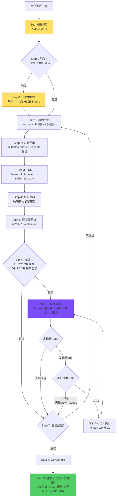

# Fix Bug Workflow - 规范化 Bug 修复工作流

## Overview

本工作流定义了一个完整的、系统化的 Bug 修复流程，包含 10 个标准化步骤（Step 0-9）：从错题本检索、根因分析到方案评审、TDD 测试、服务重启、浏览器验证、全局冒烟测试，最终输出文档并提交。核心亮点是 **Step 6 全平台冒烟测试**--将"修复局部 Bug"提升为"修复局部 Bug + 保障全局平台质量"，自动智能发现关联 bug 并递归修复。

**使用场景**：当用户报告 Bug 时，使用本工作流系统地修复。

**🆕 v1.2 caveman 输出压缩**：如果用户已安装 caveman skill，在修复过程中按步骤自动切换压缩强度。全程启用，不中断流程。不安装则无影响。

```markdown
# 分步骤强度（自动切换，无需手动操作）：

| 步骤 | caveman 模式 | 原因 |
|------|-------------|------|
| Step 1-3 根因分析 / 方案评审 / TDD | `full` | 简短有力，保留技术细节和代码 |
| Step 5 浏览器验证 / Step 6 冒烟 | `ultra` | 只保留通过/失败/截图路径 |
| Step 8 Git Commit message | `lite` | 保留完整语义，删除客套话 |
| Step 9 文档沉淀（错题本） | 不启用 | 错题本需要完整可读性 |
```

**注意**：caveman 仅压缩回答文本（输出 token），不改变代码质量、不压缩思考过程、不影响生成的代码。

## 步骤强度映射表（v1.5 重编号后）

条件触发的步骤按 Bug 严重等级（P0-P3）自适应开关，非条件步骤全部执行：

| Step | 名称 | P0 | P1 | P2 | P3 | 触发条件 |
|------|------|:--:|:--:|:--:|:--:|---------|
| 0 | 错题本经验检索 | ✅ | ✅ | ⏭️ | ⏭️ | P0/P1 或用户要求 |
| 1 | System Debug 根因分析 | ✅ | ✅ | ✅ | ✅ | 始终 |
| 2 | 方案评审 | ✅ | ✅ | ✅ | ✅ | 始终 |
| 3 | TDD 测试驱动 | ✅ | ✅ | ✅ | ✅ | 始终 |
| 4 | 服务重启验证 | ✅ | ✅ | ✅ | ✅ | 涉及后端代码（Python/FastAPI/scheduler） |
| 5 | 浏览器验证 | ✅ | ✅ | ✅ | ✅ | 涉及前端可见行为 |
| 6 | 全平台冒烟 | ✅ | ✅ | ⏭️ | ⏭️ | ≥3 文件 / 跨前后端 / P0 / 用户要求 |
| 7 | 迭代循环 | ✅ | ✅ | ✅ | ✅ | 始终（验证未过时回退） |
| 8 | Git Commit | ✅ | ✅ | ✅ | ✅ | 始终 |
| 9 | 文档输出双写 | ✅ | ✅ | ✅ | ✅ | 始终 |

## Superpowers 技能嵌入映射

本技能的关键步骤**必须调用**对应的 superpowers 子技能来执行，而非让 AI 自由发挥：

| 本技能步骤 | 调用的 Superpowers 技能 | 调用理由 |
|-----------|------------------------|---------|
| Step 0: 错题本检索（条件触发） | `query-knowledge`（predev + project-note + codegraph 三后端） | P0/P1 借鉴同类 Bug 模式,避免重复踩坑;P2/P3 跳过节省时间。统一走 query-knowledge 入口 |
| Step 1: 根因分析 | `systematic-debugging`（4 Phase 骨架）+ `diagnosing-bugs` 补丁（强制 red-capable 循环/4 checklist/多假设 + 内建 TDD）| systematic 提供 4 Phase 系统化框架；diagnosing-bugs 嵌入 3 个补丁。**hybrid 嵌入**不是替换 |
| Step 3: TDD | `test-driven-development` + Seam + Anti-pattern 子检查 | 强制测试先行 + 4 个 checklist（Seam/实现耦合/同义反复/横向切片）。抗重构率 ≥85% |
| Step 4: 服务重启 | 无（内置步骤） | 后端代码必须重启生效；不重启的修复 = 没修复 |
| Step 5: 浏览器验证 | `verification-before-completion`（**条件嵌入**，见 Step 5 说明） | 强制"证据优先"--必须有截图/日志/输出为证 |
| Step 6: 全局冒烟测试 | 无（内置步骤） | 智能发现关联 bug，将局部修复提升至全局平台质量保障 |
| Step 8: Git Commit | `verification-before-completion` | 提交前最终验证--测试套件通过 + 无回归 |

**调用规则**：
1. 以上步骤**不可跳过**对应的 superpowers 技能调用（P2/P3 可跳过 Step 5）
2. AI 在进入这些步骤时，必须先使用 `Skill` 工具调用对应的 superpowers 技能，再执行该步骤
3. 如果 superpowers 技能的检查不通过，**不可进入下一步**
4. **Step 1 必须显式产出 red-capable 命令 + 跑过一次的输出**；Step 3 在 P0/P1 必须先过 4 项 Seam + Anti-pattern checklist

---

## Bug 分级（按严重程度自适应）

在进入 Step 1 前，必须先对 Bug 进行分级：

| 级别 | 判定条件 | 执行步骤 | 适用场景 |
|------|---------|---------|---------|
| **P0 严重** | 核心功能不可用、数据丢失/损坏、安全漏洞 | 全流程 10 步（含 Step 6） + 必须浏览器验证 + 建议人工 review | 线上崩溃、数据错误、权限绕过 |
| **P1 普通** | 功能异常但有 workaround、影响用户体验 | 标准 10 步（含 Step 6） | 交互异常、显示错误、性能下降 |
| **P2 轻微** | 边界 case、非核心路径、不影响主流程 | 精简：Step 1 -> Step 2 -> Step 3 -> Step 5 -> Step 8（可选 Step 6） | 边界条件、日志格式、次要样式 |
| **P3 拼写/样式** | 纯文本/样式问题，无逻辑影响 | 一句话根因 -> 直接修 -> 提交（跳过 Step 6） | typo、颜色微调、文案修改 |

**Step 6 强制触发条件**（以下任一满足即不可跳过）：
1. 本次修改涉及 **≥3 个文件**
2. 本次修改**跨前端+后端**
3. 用户**明确要求**全量功能验证
4. P0 级别 bug

**Step 6 跳过条件**（以下全部满足才可跳过）：
- 修改 ≤2 个文件 且 仅涉及单层（纯前端或纯后端）
- 非 P0 级别
- 用户未要求全量验证

**降级规则**：如果调查中发现实际严重程度高于初始判断，**必须升级**并重新走对应流程。不可降级。

---

## 工作流步骤

### Step 0: 错题本经验检索 - 借鉴同类 Bug 模式（条件触发）🔧

**触发条件**（满足任一即执行）：
- Bug 分级为 **P0**（核心功能不可用/数据丢失/安全漏洞）
- Bug 分级为 **P1**（功能异常/影响用户体验）
- 用户明确说"查错题本"/"看历史 bug"等关键词

**跳过条件**（全部满足才跳过）：
- Bug 分级为 **P2/P3**（边界 case/纯样式/拼写）
- 用户未要求

**目标**：在根因分析前，**借鉴同类 Bug 的历史经验**，避免重复踩坑。例如：
- 修"端口 401"时 -> 检索是否之前有"端口错配"案例
- 修"工具调用失败"时 -> 检索是否之前有"工具名拼写错误"案例
- 修"前端 SSRF 拦截"时 -> 检索是否之前有"安全策略误配"案例

**执行内容**：

#### 1. 确定检索范围

从用户报告的 Bug 现象中提取关键词：
- **症状关键词**：用户原话里的关键名词/动词（例："http_request", "工具名错", "端口 8000"）
- **模块关键词**：涉及的 skill/路由/文件/类名
- **错误信息关键词**：报错信息中的 token（例："blocked internal address"）

#### 2. 调用 query-knowledge 统一检索（替代手动 grep）

**A. 错题本模式匹配**（predev 后端，按变更范围检索）：
```bash
python3 skills/query-knowledge/scripts/query_knowledge.py \
    --repo . --backend predev --json \
    pd-scan --layer <frontend|backend|both> \
            --tech <技术1> --tech <技术2> \
            --file <涉及文件>
```
返回匹配的 Bug 模式规则 + `.claude/artifacts/bugs/*/knowledge/*.md` 知识文件。

**B. 项目知识库检索**（project-note 后端，bugfix 场景自动加权错题本）：
```bash
python3 skills/query-knowledge/scripts/query_knowledge.py \
    --repo . --backend project-note --json \
    search "<症状关键词+模块关键词>" --context bugfix --top 5
```
`--context bugfix` 会让 `06-迭代与变更/已知问题与陷阱.md` 加权 2x，让已知 Bug 模式排到 top。

**C. 代码符号检索**（codegraph 后端，定位 Bug 相关函数）：
```bash
python3 skills/query-knowledge/scripts/query_knowledge.py \
    --repo . --backend codegraph --json \
    cg-search "<错误信息中的函数名/类名>" --limit 5
```

#### 3. 输出≤5 条相关经验

格式：
```markdown
### Step 0 检索结果

匹配到 N 条相关历史经验（已按相关性排序）：

#### 经验 1: <错题本标题> (来源: <路径>)
- **模式**：1 句话概括
- **触发条件**：什么情况下会触发
- **历史根因**：之前是怎么修的
- **本次应用**：本次 Bug 是否同源/部分相关？
  - 同源 -> 作为 Step 1 的 H1 候选假设（最高优先级）
  - 部分相关 -> 借鉴检测规则
  - 不相关 -> 跳过

无匹配时："✅ 错题本检索无匹配，本 Bug 可能是新模式，按正常流程进入 Step 1 根因分析。"
```

#### 4. 应用决策

**🆕 v1.5 修复（V4）**：错题本是"假设来源"不是"免验金牌"。无论匹配度多高，**都必须进 Step 1 建 red-capable 循环验证**，不允许跳过根因确认。

- **完全同源** -> 把历史根因 + 检测规则作为 Step 1 的 **H1 候选假设**（最高优先级），仍必须进 Step 1 建 red-capable 循环验证。验证通过才可复用方案进 Step 2。
  - **禁止**：跳过 Step 1 直接进 Step 2（错题本匹配 ≠ 根因确认，表象相同但根因不同的 bug 会被误修）
- **部分相关** -> 把检测规则作为 Step 1 的额外检查项
- **不相关** -> 标记到 Step 9 输出时沉淀新错题本

**为什么不阻塞流程但不免验**：
- P2/P3 bug 跳过本步节省时间（本步本身是条件触发）
- 即使错题本匹配上，根因仍需 red-capable 验证--避免经验主义陷阱
- 错题本加速的是"假设生成"，不是"验证跳过"

**与 query-knowledge 的关系**：
- predev 后端匹配「通用 Bug 模式规则」+ `.claude/artifacts/bugs/` 知识文件
- project-note 后端（`--context=bugfix`）查 KB 里的「已知问题与陷阱」文档
- codegraph 后端定位 Bug 相关代码符号 + 影响面
- 三后端可独立调用，也可用 `--backend=all` 一次性聚合

---

### Step 1: System Debug - 根因分析 🔧 `systematic-debugging` + `diagnosing-bugs` hybrid

**调用**：执行前必须使用 `Skill` 工具调用 `systematic-debugging`（**4 Phase 系统化框架**），并在每个 Phase 内嵌入 `diagnosing-bugs` 的 3 个具体补丁--hybrid 嵌入而非替换。

**🆕 v1.5**：若 Step 0 命中「完全同源」，历史根因作为 H1 候选假设（最高优先级），但 red-capable 循环仍必须建立。

**为什么是 hybrid 而不是替换**：
- systematic-debugging 强：多组件系统诊断、模式分析、3 次失败熔断、修复范围控制（no "while I'm here"）
- diagnosing-bugs 强：**Phase 1 强制先建 red-capable 循环**（防"读代码造理论"反模式）、4 条完成 checklist、3-5 个假设而非单假设、内建 TDD、Post-mortem
- 所以做的是：**systematic 做骨架 + diagnosing 在 Phase 1 和 Phase 3 做补丁**

#### 调用与执行顺序

1. **Skill(systematic-debugging)** -> 拿到 4 Phase 框架
2. **Phase 1 (Root Cause Investigation)**：执行 systematic 的 5 步骤 + **强制 diagnosing 补丁 A**
3. **Phase 2 (Pattern Analysis)**：完全按 systematic，无需修改
4. **Phase 3 (Hypothesis and Testing)**：执行 systematic 的"单假设" + **强制 diagnosing 补丁 B（升级为 3-5 假设）**
5. **Phase 4 (Implementation)**：执行 systematic + **强制 diagnosing 补丁 C（内建 TDD，5 步 RED-GREEN-VERIFY-CLEANUP-POSTMORTEM）**

#### Phase 1 实施细节（systematic 5 步 + diagnosing 补丁 A）

**systematic-debugging Phase 1 原版（必须执行）：**

1. **Read Error Messages Carefully** - 不跳过任何 error/warning
2. **Reproduce Consistently** - 能否可靠触发？步骤精确？
3. **Check Recent Changes** - git diff / 新依赖 / 配置变化
4. **Gather Evidence in Multi-Component Systems** - 多组件系统每个边界加日志
5. **Trace Data Flow** - `root-cause-tracing.md` 反向追溯

**diagnosing 补丁 A（在 Phase 1 第 2 步后插入，**强制**执行）**：

- **🔴 铁律**："If you catch yourself reading code to build a theory before this command exists, **stop**"
- **禁止**跳过循环直接进 Phase 2/3/4 -> **没有 red-capable 命令，不能进 Phase 2**
- **建立反馈循环**（按优先级选 1-2 种）：
  1. Failing test（首选，最优）
  2. curl/HTTP 脚本
  3. CLI 调用 + stdout diff
  4. Playwright/Puppeteer headless 浏览器
  5. 录制 trace -> 重放
  6. Throwaway harness
  7. Property/fuzz loop（非确定性 bug）

- **🔴 循环必须通过 4 条 checklist（缺一不可）**：
  - [ ] **Red-capable**：能复现当前 bug 的精确症状（不是"没崩"）
  - [ ] **Deterministic**：每次跑结果一致（flaky bug 需提高复现率 ≥50%）
  - [ ] **Fast**：秒级，不是分钟级
  - [ ] **Agent-runnable**：无人值守可跑（必须把这条命令和你已跑过一次的输出粘贴出来证明）

- **Tighten the loop**：循环达标后优化（更快/更 sharp/更确定性）
- **Non-deterministic bug 处理**：循环触发 100× 并行，**目标不是 clean repro，而是高复现率**（50% 可 debug，1% 不行）
- **建不了循环时**：停下来明确说，列尝试清单，让用户提供 HAR/log/access

**为什么补丁 A 必须嵌入**：避免 systematic Phase 1 第 5 步"Trace Data Flow"把 agent 带偏到"先读代码造理论再验证"的反模式--纯逻辑 bug（无错误消息）尤其容易踩这个坑。

#### Phase 3 实施细节（systematic 单假设 + diagnosing 补丁 B 多假设）

**systematic-debugging Phase 3 原版（必须执行）：**

1. **Form Single Hypothesis** - 写下来："I think X is root cause because Y"
2. **Test Minimally** - 最小变更，单变量
3. **Verify Before Continuing** - 成功进 Phase 4；失败**重新假设**
4. **When You Don't Know** - 诚实承认

**diagnosing 补丁 B（在第 1 步升级单假设->多假设）**：

- 必须**列出 3-5 个候选假设**（不是单假设），然后排序：
  - H1：[最可能的根因] - 验证方式：[red-capable 命令]
    - **🆕 v1.5**：若 Step 0 命中完全同源，H1 = 历史根因（标注来源 lesson.md 路径）
  - H2：[次可能] - 验证方式
  - H3：[兜底假设]
- **逐个用同一个 red-capable 命令验证**（已经是循环了所以便宜）
- **找根因不是第 1 假设命中即可**，而是**前 3 个都没命中就该暂停重读 Phase 1 证据**

**为什么补丁 B 优于单假设**：单假设容易让 agent 沉迷于"修这个试试"，多假设 + 强循环能在 1-2 轮内收口，省时间。

#### Phase 4 实施细节（systematic 修复 + diagnosing 补丁 C 内建 TDD）

**systematic-debugging Phase 4 原版（必须执行）：**

1. **Create Failing Test Case** - 引用 test-driven-development skill
2. **Implement Single Fix** - 一处变更，no "while I'm here" improvements
3. **Verify Fix** - 测试转绿，无回归
4. **If Fix Doesn't Work** - < 3 次重做 Phase 1；**≥ 3 次停止质疑架构**
5. **If 3+ Fixes Failed: Question Architecture** - 熔断

**diagnosing 补丁 C（内建 TDD 5 步）**：

- **第 1 步**：用 Phase 1 已有的 red-capable 命令 -> 已是 failing test
- **第 2 步**：写最小实现让 test 转绿（不要提前 anticipate）
- **第 3 步**：跑一遍 Phase 1 的 tight loop -> 绿
- **第 4 步**：Cleanup（去掉 instrumentation、去掉 print、加到测试套件）
- **第 5 步：Post-mortem**（诊断完动手记录错题本）
  - 为什么花这么多时间？
  - 哪个 Phase 跳过/偷懒了？
  - **v1.4.3 H1 是真根因还是表象根因？**（修复让 red-capable 转绿只证明症状切断，不证明根因到位。有没有更深层的共同原因？检测规则必须描述真根因，不是这次碰巧修对的表象--否则错题本会教下次 AI 也修表象）
  - 检测规则：[如何下次自动识别同类 bug] -> 写入 `.claude/artifacts/bugs/<bug-name>/knowledge/lesson.md`
  - 标准修复模板：[下次可直接套用]

#### 红灯警告（必须停止并回到分析）

- "quick fix for now" / "just try X and see" / "while I'm here, also fix XXX"
- 每个修复都暴露新问题（在不同地方）
- 已尝试 2+ 次仍未解决（**3+ 次停止质疑架构**）
- **跳过 red-capable 循环直接猜根因** -> 立即回到 Phase 1 第 2 步建循环
- **假设只能列 1 个** -> 强迫列 3-5 个
- **修复完不写错题本** -> 强迫走 Post-mortem
- **🆕 v1.5**：Step 0 命中完全同源但跳过 Step 1 red-capable 验证 -> 立即回 Step 1 建循环

**输出**：记录到 `@phase1_root_cause.md`，包含：
- Bug 描述
- 触发条件
- 根因分析
- **red-capable 命令 + 跑过一次的输出**（强制要求）
- 数据流追踪路径
- **3-5 个候选假设与验证记录**（H1 若来自 Step 0 错题本，标注来源路径）
- **Post-mortem**（如已修复）

---

### Step 2: Solution Review - 方案评审

**目标**：在写代码前，评审修复思路是否正确，避免修错方向。

**定位**：此阶段评审的是"修复方案"而非代码（代码评审在 Step 3 TDD 中写完代码后顺手完成）。

**🆕 v1.5 守卫（V4 配套）**：若来自 Step 0「完全同源」路径，**必须附 Step 1 red-capable 循环验证输出**（证明本次确为同根因），否则拒绝评审、回 Step 1。

**执行内容**：
1. 检查修复方案是否正确针对了根因（而非表象）
2. 检查修复方案是否会破坏现有架构（SOLID 原则）
3. 检查是否有更简单的方式（DRY / KISS / YAGNI）
4. 检查是否影响其他模块（依赖关系）
5. 确认修改范围最小化
6. 评审通过后输出评审意见

**输出**：记录到 `@phase2_review.md`，包含：
- 评审结论（通过 / 需修改）
- 发现的问题
- 建议的修改方案
- **🆕 v1.5**：若来自 Step 0 同源路径，附 red-capable 验证引用

---

### Step 3: TDD - 测试驱动开发 🔧 `test-driven-development` + Seam + Anti-pattern 子检查

**Seam + Anti-pattern 子检查**（Step 3 开头 30 秒，P0/P1 必须执行，P2/P3 可选）：

写测试前先答这 4 个问题（**不通过 -> 改测试，不许绕过**）：

- [ ] **Seam 确认**：我在测的是 public interface 吗？
  - ✅ HTTP 路由 -> 用 `client.get/post(...)` 测响应契约
  - ✅ 导出函数 -> 测返回值 / 异常
  - ❌ 内部函数 / private 方法 / 实现细节 -> 不测
- [ ] **Anti-pattern 1: 实现耦合**：测试会因为换实现方式而 fail 吗？会 -> 改测接口契约
  - 例：测了 `request.get_json()` 的具体返回值结构 -> 换请求解析器就崩
- [ ] **Anti-pattern 2: 同义反复 (Tautological)**：期望值是独立的 source of truth 吗？
  - ✅ 已知常量字面量 `expected = 5`（人手算的）
  - ❌ 按代码 logic 重算 `expected = a + b`（永远绿）
- [ ] **Anti-pattern 3: 横向切片**：我在测 1 个 vertical slice 吗？
  - ✅ 1 个测试 = 1 个用户场景 = 端到端 1 个具体断言
  - ❌ 把解析 / 提取 / 计算拆开各自测 -> 合在一起的 bug 看不见

**为什么 +200-400 tokens 换这个值得**：抗重构率从 60-70% 提升到 ≥85%；未来重构 / 换框架 / 加校验不会假阳性 fail；同事改代码的 bug 不会被同义反复测试藏住。

---

> **⭐ 自适应测试匹配（🆕 v1.5 收敛到 test-pyramid-builder）**：本步骤根据 Bug 严重程度自动选择匹配深度，**统一调用 `test-pyramid-builder` 的 select_tests.py**，不再在本 Skill 内维护匹配算法。

**调用方式**：
```bash
python3 skills/test-pyramid-builder/scripts/select_tests.py \
    --changed-files <file1>,<file2> \
    --depth <L1|L2|L3|L4> \
    --json
```

**depth 映射**（按 Bug 严重等级）：
- P3 -> L1 文件名匹配（~5s）
- P2 -> L2 同目录 + 符号引用（~10s）
- P1 -> L3 金字塔层级（mock 天花板需手动调 test-pyramid-builder 完整检查）（~30s）
- P0 -> L4 全影响面 + 依赖追踪（~60s）

输出：`{ "selected": [...], "skipped_count": N, "depth_used": "L2", "layers_checked": [...] }`

**匹配结果处理**：
- **找到匹配测试** -> 运行（RED 阶段），验证 Bug 存在
- **没找到 + P3/P2** -> 可选跳过或生成 1 层最相关测试
- **没找到 + P1/P0** -> 调用 `test-pyramid-builder` 生成缺失层的测试

**调用规则**：
1. **必须先调用 select_tests.py**（不再内联 find/grep 逻辑）
2. **找到了匹配测试** -> 直接运行，调用 `test-driven-development` 执行 RED-GREEN 循环
3. **没找到且必须生成** -> 调用 `test-pyramid-builder` 按金字塔层生成，再调用 `test-driven-development` 执行 RED-GREEN

**为什么收敛到 select_tests.py（D6 修复）**：
- 消除 deep-planning 阶段7.0 / fix-bug Step 3 / test-pyramid 三套重复的测试选择逻辑
- 算法唯一源在 `test-pyramid-builder`，其他 Skill 调用脚本而非复制逻辑
- `find` + `grep` 仍是底层实现，但封装在脚本里，改一处即改全局

---

### Step 4: Service Restart & Health Check - 服务重启验证 🔧

**触发条件**：任何涉及**后端代码**（Python/FastAPI/scheduler）的修复都必须执行此步骤。纯前端修复可跳过。

**为什么必须重启**：Python 是解释型语言，修改源码不会自动生效。uvicorn 没有 `--reload` 时不会热加载。不重启的修复 = 没修复。

**执行内容**：

1. **停止旧进程**：
   ```bash
   kill $(ps aux | grep "uvicorn.*app.main" | grep -v grep | awk '{print $2}')
   kill $(ps aux | grep "scheduler_worker.py" | grep -v grep | awk '{print $2}')
   ```

2. **启动新进程**（必须从 PROJECT_DIR/backend 目录启动）：
   ```bash
   cd /path/to/backend
   nohup python -c "import uvicorn; uvicorn.run('app.main:app', ...)" > /tmp/backend.log 2>&1 &
   nohup python scheduler_worker.py > /tmp/scheduler_worker.log 2>&1 &
   ```

3. **健康检查**（必须等待启动完成后验证）：
   ```bash
   sleep 12 && curl -s http://localhost:8000/api/health
   # 期望: {"status":"healthy","version":"1.0.0","database":"connected"}
   ```

4. **检查启动日志**：确认无 `ERROR` / `ModuleNotFoundError` / `ImportError`

5. **修复端点验证**：至少调用 1 次被修复的 API，确认返回正常

**红灯清单**（出现任一项必须回到 Step 1）：
- `ModuleNotFoundError` / `ImportError`
- `curl` 返回空或连接拒绝
- 日志中出现新的 `ERROR`
- 修复的端点仍返回旧错误

**输出**：
```markdown
### Step 4: 服务重启验证

- 旧进程: [PID] 已终止
- 新进程: [PID] 启动成功
- Health check: {"status":"healthy"}
- 启动日志: 无 ERROR
- 修复端点: curl /api/xxx -> 200 OK, 数据正确
```

---

### Step 5: Browser Test - 浏览器验证 🔧 `verification-before-completion`（条件嵌入）

**🆕 v1.5 条件嵌入（D3 修复）**：verification-before-completion 的嵌入按执行模式区分，避免与 deep-planning 阶段 7 重复加载：
- **fix-bug 作为 deep-planning 阶段 8b 的 SubAgent 启动** -> 不嵌入，复用 Main Agent 阶段 7 的验证清单（SubAgent 启动包附验证清单子集）
- **fix-bug 独立执行**（非 SubAgent） -> 嵌入 `verification-before-completion`（原逻辑）

**🆕 v1.6 渐进式披露到 e2e-excellence**：本步的浏览器验证执行时，渐进式披露到 `e2e-excellence` skill 跑完整验证路线（10 项 Gate + 回归测试 + trace/video 证据），跑完带着结果回 Step 7 文档沉淀。

**目标**：在真实浏览器环境中验证修复效果。

**执行内容**：
1. 启动开发服务器（`npm run dev`）
2. 使用 Playwright 进行端到端测试
3. 验证修复后的行为符合预期
4. 验证边界情况和错误处理

**🆕 v1.6 渐进式披露调用模板**：

```markdown
### E2E 验证（渐进式披露到 e2e-excellence）

**入口契约**：
- 验证目标：bug 修复（本 Step 1 的根因）
- 验证范围：[bug 涉及的路由/API/交互，从 Step 1 根因分析提取]
- 预期行为：
  - 成功路径：[修复后应有的正确行为]
  - 失败路径：[如修复未生效，应捕获到回归]
- 回归测试：要求新建 `tests/e2e/regression/bug-<id>-<desc>.regression.spec.js`
- 返回位置：Step 7 文档沉淀
- gate_waiver（可选，v2.2）：[声明 pre-existing Gate 失败项豁免，如 "Gate 8: 历史文件弱断言（非本次引入）"；CI 禁用]

**调用**：使用 `e2e-excellence` skill 执行验证路线 Step 1-8。

**出口契约（验证后填写）**：
- 门禁判定：[PASS / PASS_WITH_WARN / BLOCKED]
- 统计：[X PASS / Y WARN / Z FAIL / W WAIVED]
- 测试结果：[X passed / Y failed / Z skipped]
- 证据产物：[trace.zip / video.webm / screenshot.png 路径]
- 验证报告：[memory/bug-<id>-e2e-validation-<date>.md]
- 回归测试：[tests/e2e/regression/bug-<id>-<desc>.regression.spec.js]

带着结果返回 Step 7 文档沉淀（把验证报告链接写入修复报告）。
```

**输出**：记录到 `@phase5_browser_test.md`，包含：
- 浏览器测试截图
- 测试步骤和结果
- 🆕 e2e-excellence 出口契约（门禁判定 + 证据产物路径 + 验证报告链接）

---

### Step 6: Global Platform Smoke Test - 全平台冒烟测试 🔧

**触发条件**（满足任一即执行）：

| 触发条件 | 说明 |
|---------|------|
| 修改 ≥3 个文件 | 代码量较大，影响面广，需验证全局 |
| 跨前端+后端修改 | 跨层修改可能导致数据流断裂 |
| P0 级别 Bug | 核心功能不可用，需确认无连锁损坏 |
| 用户要求全量验证 | 用户明确要求 |

**跳过条件**（全部满足才可跳过）：
- 修改 ≤2 个文件，且仅涉及单层（纯前端或纯后端），且非 P0，且用户未要求全量验证

**v1.6.3 Phase E 例外**：即使满足上述跳过条件（Step 6 整体跳过），只要当前项目同时存在明确 SDD 与 KB 业务流目录，Phase E 仍必须独立执行。两者都不存在才可记录跳过；只缺其一必须 `BLOCK`，不得以 `find` 的任一命中、历史 manifest 或旧测试替代当前输入。原因：Phase E 证明「业务流未被破坏」，与冒烟测试的「功能正常」是两道独立门禁。

**目标**：将"修复局部 Bug"提升为"修复局部 Bug + 保障全局平台质量"。自动智能地发现本次修改可能影响的其他功能，以及平台上预存但未被发现的 Bug。

**核心理念**：
```
局部修复 -> 全局验证 -> 发现新 Bug -> 依次修复 -> 平台质量螺旋上升
```

**执行内容**：

#### Phase A: 平台功能清单获取（🆕 v1.5 改查 KB，T4 修复）

**优先从项目知识库获取**，避免重复梳理代码结构：

```bash
python3 skills/query-knowledge/scripts/query_knowledge.py \
    --repo . --backend project-note --json \
    search "核心功能 API 路由 模块 业务流" --top 5 --context feature
```

从命中的 `03-核心数据业务流` / `02-功能结构和策略` 文档提取功能清单（API 端点 / 前端页面 / 业务数据流）。

**降级逻辑**：若 KB 无对应文档（`kb_source: not-found` 或 search 无命中），降级为原逻辑（读代码结构识别核心功能），并在输出中标记「数据来源：降级读码，建议补建 KB」。

**输出功能清单**到 `06-smoke-test.md`：
```markdown
## 平台核心功能清单（数据来源：KB / 降级读码）

### 功能 1: 项目管理
- API: GET/POST /api/projects, DELETE /api/projects/:id
- 前端: 首页项目列表, 添加项目表单
- 数据流: 用户输入路径 -> POST -> 数据库 -> 列表渲染

### 功能 N: ...
```

#### Phase B: API 层冒烟测试

对每个核心功能的 API 端点，发送请求并验证：

1. **HTTP 状态码** 200/201（非 4xx/5xx）
2. **响应格式** 符合预期 JSON 结构
3. **关键字段** 非空、类型正确
4. **后端日志** 无 ERROR/Exception

```bash
echo "=== API Smoke Test ==="
for endpoint in \
  "GET /api/projects" \
  "GET /api/chains/projects/1/chains" \
  "GET /api/executions?project_id=1"; do
  method=$(echo "$endpoint" | cut -d' ' -f1)
  path=$(echo "$endpoint" | cut -d' ' -f2)
  code=$(curl -s -o /dev/null -w "%{http_code}" -X "$method" "http://localhost:8000$path")
  [ "$code" = "200" ] && echo "✅ $method $path -> $code" || echo "❌ $method $path -> $code"
done
```

#### Phase C: 前端层冒烟测试

使用 Playwright 浏览器自动化，对每个核心前端页面验证：

1. **页面加载** - 无白屏/控制台无 error
2. **核心交互** - 关键按钮可点击、表单可输入
3. **数据渲染** - 列表/详情正常展示（非空状态也合理）
4. **跨页面导航** - 路由跳转正常

#### Phase D: 端到端核心链路测试

选取平台 **1-2 条最核心的业务链路**，进行完整的端到端测试：

1. 从用户操作开始
2. 经过完整的 API 调用链
3. 到前端最终展示
4. **记录每个环节的状态**

#### Phase E：业务正确性质检门禁（唯一业务质量入口）

**定位**：Phase B/D 验证接口或界面能运行；Phase E 验证当前实现是否仍满足 KB/SDD 约束。Phase E 只能调用 `ai-quality-engine/scripts/business-quality-gate.py`，禁止在本流程中手工生成 manifest、扫描历史测试目录、分别跑 pytest 或人工判读引擎 JSON。

**触发与输入完整性**：

1. 当前项目同时存在 SDD 与 KB 业务流目录时，Phase E 必须执行；纯前端、纯判定或“看起来无关”的修改也不得跳过。
2. 两者都不存在时，才可在 `06-smoke-test.md` 标注 `Phase E 跳过：无契约/KB 文档`。
3. 只存在其中一项时是 `BLOCK`，不是跳过；必须补齐输入或明确移出业务质量链路。
4. SDD 必须选择一个明确版本的文件 `docs/vX.Y.Z/契约规范.md`，禁止 `docs/v*/契约规范.md` glob。KB 必须使用 `docs/project-note/03-核心数据业务流/` 目录，禁止虚构的 `03-核心数据业务流.md`。

**执行前准备**：

- 确定本轮实际改动涉及的业务入口源文件，作为 `--target`；
- 为真实公开入口准备验证器：CLI、HTTP、app factory 或公开模块入口任选其一；
- 验证器必须写入 `$BUSINESS_QUALITY_VERIFY_EVIDENCE`，满足 `business-verification-v1`：回显 run id、SDD/KB/目标代码 hash，并含至少一项通过的 `return-value`、`error-code`、`state-transition` 或 `side-effect` 业务断言；
- 不能提供真实验证器时只能执行 `schema-only` 用于暴露解析缺口，结果固定是 `BLOCK`，不得作为修复完成证据。

**唯一调用命令**：

```bash
python3 skills/ai-quality-engine/scripts/business-quality-gate.py \
  --project-root . \
  --sdd docs/vX.Y.Z/契约规范.md \
  --kb docs/project-note/03-核心数据业务流/ \
  --target <本轮业务入口源文件> \
  --output-dir tests/oracle \
  --run-id bug-<bug-name>-<不可复用ID> \
  --evidence-level code-verified \
  --verify-command "python3 <真实业务验证器>.py"
```

`--verify-command` 是无 shell 的程序及参数，禁止传 `;`、`&&`、管道或重定向。命令成功但未写出有效业务断言证据仍为 `BLOCK`。

**纯前端/纯后端（无跨端契约）**：本次改动明确无 API/SSE 变更时，用 `--no-sdd` 显式声明（不能省略），KB 与真实验证器仍必须提供；SDD 已存在但本次未涉及契约时，仍用 `--sdd` 传当前版本契约文件：

```bash
python3 skills/ai-quality-engine/scripts/business-quality-gate.py \
  --project-root . \
  --no-sdd \
  --kb docs/project-note/03-核心数据业务流/ \
  --target <本轮业务入口源文件> \
  --output-dir tests/oracle \
  --run-id bug-<bug-name>-<不可复用ID> \
  --evidence-level code-verified \
  --verify-command "python3 <真实业务验证器>.py"
```

**`--sdd` 版本归属（自动校验）**：门禁要求契约文件 H1 首行版本号（`# vX.Y.Z 契约规范`）与父目录名 `docs/vX.Y.Z/` 一致，防止把旧版本契约当作本轮证据。

**`--changed-files` 防漏检（推荐）**：传入本轮 `git diff --name-only` 结果，门禁会校验其中的业务入口文件（`.py/.ts/.tsx/.js/.jsx`，排除 tests/*.test.*/*.spec.*）都已列入 `--target`，否则 BLOCK：

```bash
  --changed-files "$(git diff --name-only)" \
```

统一门禁自动执行当前 Contract/Scenario 生成、仅本轮生成测试的 pytest、hash/run id 绑定、真实证据校验和本仓自带引擎的 `--strict-gate` 判定。它不会重用 `tests/contract/`、`tests/scenario/` 或旧 `tests/oracle/` 的产物。

**结果与失败处理**：

| 结果 | 退出码 | 动作 |
|---|---:|---|
| `PASS` | 0 | 继续 Phase F；将 run id、命令、`gate-result.json` 路径、PASS 和 blocking findings=空写入 `06-smoke-test.md` |
| `BLOCK` | 3 | 记录“业务验证偏离”，进入 Phase F/G 修复；不得人工降级、跳过或复用旧 run |
| 参数错误 | 2 | 修正 SDD、KB、target、run id 或验证器，再用新 run id 重跑 |

以下全部是阻断条件：extractor 失败、空/非法 manifest、Oracle pytest 失败、真实验证失败或 hash/run id 不匹配、`schema-only`、`aggregate_status != valid`、`O-CONTRACT-GAP`、`O-SCENARIO-GAP`、`O-MOCK-CEILING`、低 coverage、`O-TEST-FAILURE`。Critical finding 不得被总分抵消。

**证据链（强制）**：以 `tests/oracle/<run-id>/gate-result.json` 为唯一业务质量结论，报告必须同时记录 `pytest-results.json`、`business-verification.json`（只记录路径与 hash，不写入敏感原文）和 blocking findings。未留痕视为未执行；遗留的历史 manifest 不得作为本轮证据。

#### Phase F: Bug 发现与记录

如果冒烟测试发现任何问题：

1. **立即记录**到 `docs/fix-bug-result/smoke-test-findings/` 目录
2. **每个发现的问题**包含：描述、复现步骤、严重程度、相关截图/日志
3. **按严重程度排序**（P0 > P1 > P2 > P3）

#### Phase G: 依次修复新发现的 Bug

**重要：每修复一个新 Bug，必须完整走一遍 fix-bug-workflow（从 Step 0 到 Step 9）。**

**递归终止条件**：
- 所有发现的 Bug 修复完毕
- 或剩余 Bug 均为 P3 级别且用户同意暂缓
- 或连续两轮冒烟测试无新 Bug 发现

**递归熔断**：最多递归 3 层，超过后记录为 known issues 并征求用户意见。

**输出**：记录到 `06-smoke-test.md`，包含：
- 平台功能清单（标注数据来源）
- API 冒烟测试结果
- 前端冒烟测试结果
- 端到端核心链路测试结果
- 业务正确性 gate 结论（run id、evidence level、`gate-result.json` 路径、PASS/BLOCK 与 blocking findings；不将 Contract/Scenario 解析覆盖或 pytest 单独全绿描述为通过）
- 发现的 Bug 列表（如有）
- 每个发现 Bug 的修复状态

---

### Step 7: Iteration Loop - 迭代循环

**验证规则**：
- **TDD 测试通过 + 浏览器验证通过** -> 进入 Step 6（如触发条件满足）或 Step 8
- **Step 6 冒烟测试通过（无新 Bug）** -> 进入 Step 8
- **Step 6 发现新 Bug** -> 对新 Bug 递归执行 fix-bug-workflow，修复后回到 Step 7
- **Step 6 Phase E 业务质检 BLOCK**（任一输入、Oracle、pytest、真实业务验证或严格 finding 不满足）-> 按「业务验证偏离」Bug 进入 Phase G 修复，使用新 run id 重跑后回到 Step 7
- **任一验证失败** -> 回到 Step 1，从根因重新分析

**迭代限制**（按假设计数，非总次数）：
- **同一根因假设修了 2 次仍失败** -> 根因分析错了，必须重做 Step 1，不可再基于同一假设修
- **不同根因各出现一次** -> 正常迭代，不消耗任何"配额"
- 核心原则：**不要反复试同一个方案，而是质疑方案本身是否正确**

---

### Step 8: Git Commit - 提交修复

**前提条件**：Step 3、Step 5 全部通过，且 Step 6 不适用或已通过

**执行内容**：
1. 收集所有修改的文件（使用 `git diff` 查看）
2. 按照项目规范编写 commit message
3. 创建 commit
4. 运行完整测试套件验证

**Commit Message 格式**：
```
fix: [模块] 修复 [Bug 描述]

Root Cause: [根因]
Solution: [解决方案]
Test: [测试方式]
```

---

### Step 9: Documentation - 输出文档（**脱敏 + 双写，缺一不可**）

**🛑 Hard Rule - 脱敏前置 + 同时生成双产物**：

Step 9 **必须**先脱敏、再在一个动作内完成两份文件写入，**禁止只写一份**，**禁止跳过脱敏**。这是"知识闭环 + 安全闭环"的硬性门禁。

**bug-name 命名规范**（用于 9.0/9.1 所有路径）：
- kebab-case（如 `dual-ws-connection`、`port-401-mismatch`）
- 禁止空格、斜杠、中文、特殊字符
- 从 Step 1 根因分析的关键词提炼（如根因是「双 WS 连接」-> `dual-ws-connection`）
- **机械校验**（Step 9 开头必须跑）：
  ```bash
  BUG_NAME="<你的 bug-name>"
  [[ "$BUG_NAME" =~ ^[a-z0-9]+(-[a-z0-9]+)*$ ]] || { echo "❌ bug-name 必须是 kebab-case（小写字母/数字/连字符），当前: $BUG_NAME"; exit 1; }
  ```

#### 9.0 脱敏预扫描（🆕 v1.5 新增，D5 修复，强制）

错题本 lesson.md 是 AI 共享知识，会被 `query-knowledge` predev 后端检索并灌入下游上下文。**写入前必须脱敏**，否则真实 PII / 密钥会沿检索链路扩散。

对 Bug 修复报告 + 错题本草稿内容调用 sensitive-info-filter（通过临时文件传入，CLI 不支持 --scan-text）：

```bash
# 前提：Agent 在仓库根目录执行
# 1. 将报告+错题本草稿写入临时文件
TMP_REPORT=$(mktemp /tmp/bugfix-report-XXXXXX.md)
# （Agent 把报告+错题本完整内容写入 $TMP_REPORT）

# 2. 正式脱敏（单文件模式默认输出到 <file>.clean）
#    用子 shell 隔离 cd，避免命令失败后当前目录停留在 skill 目录
AUDIT_DIR="$(pwd)/.claude/artifacts/bugs/<bug-name>/.audit"
(cd skills/sensitive-info-filter && \
 python3 -m filters.__main__ "$TMP_REPORT" --audit-dir "$AUDIT_DIR")
# 净化后内容在 $TMP_REPORT.clean；审计日志在 $AUDIT_DIR

# 3. high 命中时 CLI 会 exit 2 且不写 .clean -- 按下面「命中处理」走 A/B/C 决策
#    读取脱敏后内容用 $TMP_REPORT.clean（若存在），审计记录去 $AUDIT_DIR
```

**退出码语义**：
- `exit 0` + 无命中 -> 干净，直接用原内容进 9.1
- `exit 0` + 有命中 -> 已脱敏，读 `$TMP_REPORT.clean` 进 9.1
- `exit 2` -> high 命中（私钥/Token），文件未修改，暂停走 A/B/C 决策

> **注**：sensitive-info-filter 的 `filter_text()` 方法支持 `context` 参数（用于 LLM 上下文判断），但 CLI 未暴露。如需 `--context` 能力，用 Python 调用：
> ```python
> import sys; sys.path.insert(0, "skills/sensitive-info-filter")  # 仓库相对路径
> from filters.sensitive_filter import SensitiveFilter
> f = SensitiveFilter()
> sanitized, hits = f.filter_text(report_content, context="bugfix-report")
> ```

**命中处理**（按严重度）：
- **high**（私钥/AWS Key/GitHub Token/OpenAI Key）-> 整段跳过 + 暂停等待用户确认，由 Agent 直接执行 A/B/C 决策（不依赖 sensitive-info-filter 的 evaluate_audit_decision，该方法未实现）：
  - **A. 跳过该段**（不写入 lesson.md，推荐）-- 移除含密钥的整段内容
  - **B. 人工审核后保留**（确认是占位符示例）-- 标注「示例值，非真实凭证」后保留
    - **占位符判断标准**（全部满足才可选 B）：
      - 长度 < 20 字符（真实 API key 通常 ≥ 32 字符）OR 含 `xxxx`/`example`/`test`/`demo`/`placeholder` 字样
      - 且不含能通过 Luhn 校验的数字串（排除真实银行卡）
      - 且不含符合 AWS Key 格式（`AKIA` + 16 字符）的串
    - **不满足标准或判断不清 -> 必须选 A（跳过）或 C（中止），禁止选 B**（误判会把真实密钥写入 lesson.md）
  - **C. 中止写入**（高危且无法确认）-- 停止 9.1，报告用户
- **medium**（手机号/身份证/邮箱/银行卡/内网 IP）-> 替换为 `<REDACTED:类型>`
- **low**（业务敏感词）-> 替换为 `*` × len(word)

**审计记录**：脱敏命中写入 `.claude/artifacts/bugs/<bug-name>/.filter-audit.json`（复用 sensitive-info-filter 审计格式，只存 hash 不存原文）。

**🛑 守卫**：未过 9.0 脱敏预扫描，不得写入 lesson.md。high 命中未决不得继续 9.1。

#### 9.1 双写（原逻辑，用脱敏后内容）

**输出位置**（**同一次写入**）：
- **Bug 修复报告** -> `./docs/fix-bug-result/<bug-name>-[date].md`（人类可读归档 + 完整修复过程）
- **错题本** -> `./.claude/artifacts/bugs/<bug-name>/knowledge/lesson.md`（机器消费，**单一事实源**）
  - ⚠️ 路径对齐 `query-knowledge` predev 后端的 `artifacts_dir`，下次 Step 0 检索可命中
  - ❌ **已废弃**：旧路径 `./docs/fix-bug-notes/[category].md` 不再使用

**双向链接契约（强制）**：
- 错题本 `## 相关链接` 段必须填：`- 修复报告：./docs/fix-bug-result/<bug-name>-[date].md`
- 修复报告 `## 相关错题本` 段必须填：`- 错题本：./.claude/artifacts/bugs/<bug-name>/knowledge/lesson.md`

**Step 0 命中 -> 错题本必须引用同类经验**：

如果 Step 0 检索到同类错题本，新错题本 `## 同类已沉淀经验` 段必须列出至少 1 条命中记录的链接：

```markdown
## 同类已沉淀经验
- [已存在模式A]: .claude/artifacts/bugs/<pattern-a>/knowledge/lesson.md
- [已存在模式B]: .claude/artifacts/bugs/<pattern-b>/knowledge/lesson.md
```

**Bug 修复报告内容**：
```markdown
# Bug 修复报告

## 基本信息
- Bug 名称：
- 发现日期：
- 修复日期：
- 修复人：

## 问题描述
[Bug 的详细描述]

## 根因分析
[Phase 1 的分析结果]

## 修复方案
[具体的修复代码和说明]

## 测试验证
[测试用例和测试结果]

## 浏览器验证
[验证步骤和截图]

## 涉及文件
- [修改的文件列表]

## 相关错题本
- [错题本路径：./.claude/artifacts/bugs/[bug-name]/knowledge/lesson.md]

## 相关经验检索记录
- Step 0 命中：[列出 Step 0 检索到的同类 lesson.md 路径]
- 检索结果：[命中条目数]
- 采纳结论：[对每条命中的 lesson 记录「已采用 / 不适用 + 理由」——已采用说明借鉴了哪条检测规则或修复模板；不适用说明根因不同还是场景不同]

## 脱敏审计
- 9.0 预扫描：[high/medium/low 命中数]
- 审计文件：.claude/artifacts/bugs/<bug-name>/.filter-audit.json
```

**错题本内容**：
```markdown
---
status: sanitized
sanitized: true
# Phase E 严格 PASS 后改为 status: verified 并填入实际 run id
verified_run_id: <Phase E PASS 后填入不可复用 run id>
---

# Bug 修复错题本

## 模式总结
[Bug 的抽象模式，用 1-2 句话概括]

## 触发条件
[什么情况下会触发这个 Bug]

## 根因模式
[这类 Bug 的共同根因是什么]

## 检测规则
[下次如何自动识别同类 Bug]
- 代码特征：[例如：useEffect 中使用了 setInterval 但无 cleanup]
- 运行时特征：[例如：控制台出现 "Cannot update unmounted component" 警告]
- 静态检查：[例如：grep 搜索 `setInterval(` 但在同一 useEffect 中无 `clearInterval`]

## 标准修复模板
[这类 Bug 的标准修复方式，下次可直接套用]
- 修复步骤1：[例如：添加 cleanup 函数]
- 修复步骤2：[例如：添加 isMounted ref 守卫]
- 修复代码片段：[关键修复代码]

## 预防措施
[如何从源头避免同类问题]

## 同类已沉淀经验
- [若 Step 0 命中，列出同类 lesson.md 路径]

## 相关链接
- 修复报告：[link]
- 相关代码：[link]
```

#### 9.2 受控晋升到长期 KB（v1.6.4）

9.1 的 `lesson.md` 是即时经验的**单一事实源**；长期 KB 只保存摘要，不能在未验证时直接写入。默认不触发全量 `knowledge-base-builder` 重建。

**前置条件**：

1. 9.0 脱敏已完成：lesson frontmatter 写入 `sanitized: true`；
2. Phase E 严格 gate 为 `PASS` / exit 0，且 lesson 绑定 `verified_run_id`；
3. 需要由用户明确确认晋升，禁止 Agent 自行把一次性错误写成长期事实。

合法 lesson frontmatter：

```yaml
---
status: verified
sanitized: true
verified_run_id: bug-<bug-name>-<不可复用ID>
---
```

默认将摘要晋升至 `06-迭代与变更/已知问题与陷阱.md`，同时更新同级 `变更日志.md`。此路径不改变 `03-核心数据业务流/` 的 hash，无需重跑 Phase E：

```bash
python3 skills/fix-bug-workflow/scripts/promote_lesson.py \
  --project-root . \
  --lesson .claude/artifacts/bugs/<bug-name>/knowledge/lesson.md \
  --gate-result tests/oracle/<verified-run-id>/gate-result.json \
  --kb docs/project-note/06-迭代与变更/已知问题与陷阱.md \
  --confirm
```

脚本会再次调用 `sensitive-info-filter`；high 命中、不是 `verified`、缺 `sanitized: true`、缺有效 PASS gate 都必须阻断。重复执行以 `lesson-promotion:<bug-name>` 标记幂等，不重复追加 KB 条目。

**晋升前预览**：加 `--dry-run` 会走完所有校验（脱敏、gate、状态），但不落盘，返回 `would_write_kb` / `would_write_change_log` 供人工确认后再去掉该 flag 正式写入：

```bash
python3 skills/fix-bug-workflow/scripts/promote_lesson.py \
  --lesson .claude/artifacts/bugs/<bug-name>/knowledge/lesson.md \
  --gate-result tests/oracle/<verified-run-id>/gate-result.json \
  --kb docs/project-note/06-迭代与变更/已知问题与陷阱.md \
  --confirm --dry-run
```

**存量 lesson 迁移**：历史 lesson 无 frontmatter，`predev` 已按 `legacy` 兼容，无需强制迁移；如需统一补 `status: legacy` 标记，用 `--migrate`（幂等，已有 frontmatter 的文件跳过）：

```bash
python3 skills/fix-bug-workflow/scripts/promote_lesson.py --migrate
```

**业务流例外**：若经验揭示 `03-核心数据业务流/` 的触发、数据流或异常路径事实变化，不能走默认 06 回灌；必须显式声明业务流变更、修改业务流文档后使用**新 run id**重跑 Phase E，再处理晋升。P0 的晋升器对此路径 fail-closed，防止旧 KB hash 证据被复用。

状态机：`pending → sanitized → verified → promoted`；无泛化价值可人工标 `rejected`，更准确的新 lesson 可将旧项标 `superseded`。`query-knowledge --backend predev` 默认只返回活跃状态，旧文件无 frontmatter 兼容为 `legacy`。

---

## 流程图



## 自动保存的文件名约定

输出目录统一为 `docs/fix-bug-result/<bug-name>-<date>/`：

```
docs/fix-bug-result/<bug-name>-<date>/
├── README.md                  # 修复报告（汇总）
├── 01-root-cause.md          # Step 1: 根因分析
├── 02-solution-review.md     # Step 2: 方案评审
├── 03-tdd-result.md          # Step 3: TDD 测试结果
├── 04-restart-verify.md      # Step 4: 服务重启验证
├── 05-browser-test.md        # Step 5: 浏览器验证
└── 06-smoke-test.md          # Step 6: 全局冒烟测试报告
```

> ⚠️ **错题本唯一存放位置**：所有 bug 模式 / 检测规则 / 修复模板统一沉淀到 **`.claude/artifacts/bugs/<bug>/knowledge/lesson.md`**（对齐 `query-knowledge` predev 后端），由该路径作为 single source of truth。
>
> memory 只保留关键摘要（3-5句）和指向 `.claude/artifacts/bugs/` 的路径引用。

## 与 deep-planning-rigorous-validation 联动

当在修 Bug 过程中发现需要重构（涉及 >1 个文件或有独立设计决策）：

```
fix-bug-workflow Step 3 中发现重构需求
  -> 暂停当前 Bug 修复
  -> 评估重构范围
  -> L1 重构（≤1 文件）：在当前工作流内直接完成
  -> L2+ 重构（>1 文件）：启动 deep-planning-rigorous-validation L2
     -> 完成后回到 fix-bug-workflow Step 5（浏览器验证）
```

联动时重构输出目录使用 `.claude/artifacts/changes/<refactor-name>/`，并在修复报告中记录关联。

## 使用示例

```
Skill: fix-bug-workflow

用户：修复全局终端总结显示重复的问题
-> Step 0: 错题本检索（P1，命中"双连接重复推送"历史经验 -> 作为 H1）
-> Step 1: 根因分析（建 red-capable 循环验证 H1，确认双 WS 连接）
-> Step 2: 方案评审（同源路径，附 red-capable 验证引用）
-> Step 3: 编写 TDD 测试（select_tests.py --depth L3）
-> Step 4: 服务重启验证
-> Step 5: 浏览器验证
-> Step 6: 全局冒烟测试（修改≥3文件，自动触发）
  -> Phase A: 查 KB 获取功能清单（数据来源：KB）
  -> Phase B: API 冒烟（12个端点全 200）
  -> Phase C: 前端冒烟（5个页面渲染正常）
  -> Phase D: 核心链路（全链路通过）
  -> Phase E: 统一业务质量 gate（strict PASS / exit 0，结果写入 `06-smoke-test.md`）
  -> Phase F: 发现 1 个新 Bug（P2）
  -> Phase G: 递归修复新 Bug
-> [全部验证通过] -> Step 8: 提交代码
-> Step 9: 9.0 脱敏预扫描 -> 9.1 双写报告 + 错题本 -> 9.2 严格 PASS 后经确认定点晋升 06 摘要
```

## 强制调用的 Superpowers 技能

以下技能在本工作流中**不是参考，而是强制调用**：

| 步骤 | 强制调用 | 不调用后果 |
|------|---------|-----------|
| Step 1: 根因分析 | `systematic-debugging` | 根因可能错误，后续修复白费 |
| Step 3: TDD | `test-driven-development` | 可能写成"先写代码再补测试"，失去回归保护 |
| Step 5: 浏览器验证 | `verification-before-completion`（独立执行时）+ 🆕 `e2e-excellence`（渐进式披露执行） | 靠"感觉"验证，实际可能未修复；无 Gate 门禁 + trace 证据 |
| Step 6: 全局冒烟测试 | 无（内置步骤） | 局部修复可能引入回归或残留预存 bug |
| Step 8: Git Commit | `verification-before-completion` | 提交前未做最终验证，可能引入回归 |
| Step 9: 文档输出 | `sensitive-info-filter`（9.0 脱敏） | 错题本含 PII/密钥，沿检索链路扩散 |

## 配置

**归档目录**：`docs/fix-bug-result/<bug-name>-<date>/`
**修复报告**：`docs/fix-bug-result/<bug-name>-<date>/README.md`

**注意**：详细分析和报告放 `docs/fix-bug-result/`（项目内），memory 只放 3-5 句关键摘要 + 路径引用。
