# Team Rigorous Delivery

## v3.7 变更
Stage 0 改为调 `query-knowledge kb-aware` 子命令（一次 overview+search + KB 内容 hash 缓存），与 deep-planning v3.7 对齐，消重消除。指令路径与 deep-planning 完全一致，缓存可被两侧共享。

## Overview

Hybrid orchestration skill that combines **`dispatching-parallel-agents`**' parallel dispatch model with **`deep-planning-rigorous-validation`**'s gate model. Main agent runs serial stages that require full-system view (1, 2, 3, 4, 9, 10); subagents run parallel stages within their own scope (5, 6, 7); main agent runs global post-implementation gates (8, 8b, 8c, 8d, 8e) on the integrated result.

**Core principle:** Parallelize execution where safe; gate at every boundary — subagent self-gate for slice quality, main-agent global gate for cross-slice consistency.

**Required background:** Understand both source skills before using this one. This skill is a composition, not a replacement.

## When to Use

Use when **ANY** of these triggers apply:

- **L3-scale change:** >5 changed files AND ≥3 independent design decisions
- **User-explicit team-ify request:** user says "大量任务" / "很多模块要改" / "team 化" / "并行" / "拆分并行" / "多 agent 一起做"
- **Multiple independent failure domains:** ≥3 failures in unrelated test files or subsystems (mirror of `dispatching-parallel-agents` decision)
- **Architectural prerequisite met:** slices can be defined with zero shared mutable state (no shared files, no shared schema mutation, no shared event payload)

Do **NOT** use when:

- **L1/L2 task:** ≤1 file and <20 lines (L1) or 2-5 files with 1-3 design decisions (L2) — coordination overhead exceeds benefit
- **Related failures:** fixing one slice may fix others — investigate together first
- **Shared mutable state required:** slices would touch the same files, same schema, or same event contract — race conditions on integration
- **Exploratory debugging:** root cause unknown — discover boundaries before slicing
- **Untested change surface:** number of files and decisions don't yet warrant slicing

## Stage 0: Project Knowledge Base Awareness

Before any stage begins, main agent **MUST** call `query-knowledge` to ground all subsequent stages in existing architecture, design patterns, and coding conventions. This mirrors the deep-planning-rigorous-validation "pre-step: project knowledge base awareness."

**Checklist:**
1. **Call kb-aware for overview + search in one shot** (🆕 v3.7 D2/T3 fix, replaces separate overview+search calls):
   ```bash
   python3 skills/query-knowledge/scripts/query_knowledge.py \
       --repo . --backend project-note --json \
       kb-aware --task-keywords "<task keywords>" --task-id "$TASK_ID"
   ```
   Returns `{overview: {kb_root, kb_source, cached}, search: {hit_count, hits, cached}, cache_path, kb_content_hash}`.
   - `overview.kb_source: auto-detect` / `config-file` -> KB available, continue
   - `overview.kb_source: not-found` -> record "no KB in this project", skip to step 4
   - `overview.cached: true` or `search.cached: true` -> reuse upstream feat-design retrieval (cache hit, saves ~1.5k tokens)
   - Cache path: `control-plane-state/session-drafts/$TASK_ID/kb-cache.json` (or `.runtime/kb-cache.json` without TASK_ID)

   Pick keywords by task type:
   - Architecture / design related -> "architecture layers design-patterns key-decisions"
   - State / data related -> "state-management data-model schema persistence"
   - Component / module related -> "component module-boundary service dependency"
   - API / interface related -> "API IPC SDK events background-tasks"
   - Coding conventions -> "dev-standards test-strategy CI release"
       Returns top-5 relevant L3 docs (with score / matched_sections / snippet). Only `read` top-1~2 full text.

3. **CLAUDE.md still needs manual read** (project-level hard constraints, not covered by query-knowledge)

4. If no KB (`kb_source: not-found`), record "no KB in this project", continue with normal flow

**Output (recorded in stage 1 deliverable):**
```
Knowledge base reviewed:
- Location: <kb_root from overview, or "does not exist">
- KB source: <auto-detect / config-file / not-found>
- Keywords searched: [list]
- Top hits: [path + score + snippet]
- Key findings: [architecture constraints / design patterns / coding conventions relevant to this task]
- Known pattern match: [does this task match any known pattern / trap in the knowledge base?]
```

This output **MUST** be included in the subagent prompt contract (see "Project Context (REQUIRED)").

## When to Team-ify: Quantitative Decision

```dot
digraph teamify_decision {
    "Change scale?" [shape=diamond];
    "User explicit request?" [shape=diamond];
    "Independent failure domains ≥3?" [shape=diamond];
    "Slices can be defined with zero shared mutable state?" [shape=diamond];
    "Single agent serial execution" [shape=box, style=filled, fillcolor="#fdd"];
    "L1/L2 path (no team-ify)" [shape=box, style=filled, fillcolor="#fdd"];
    "Investigate together first" [shape=box, style=filled, fillcolor="#fdd"];
    "Define slices first, then re-evaluate" [shape=box, style=filled, fillcolor="#ffd"];
    "Team-rigorous-delivery hybrid" [shape=box, style=filled, fillcolor="#dfd"];

    "Change scale?" -> "L1/L2 path (no team-ify)" [label="≤5 files OR ≤3 decisions"];
    "Change scale?" -> "User explicit request?" [label="L3: >5 files AND ≥3 decisions"];
    "User explicit request?" -> "Single agent serial execution" [label="no"];
    "User explicit request?" -> "Team-rigorous-delivery hybrid" [label="yes"];
    "Independent failure domains ≥3?" -> "Team-rigorous-delivery hybrid" [label="yes"];
    "Independent failure domains ≥3?" -> "Investigate together first" [label="no - related"];
    "Slices can be defined with zero shared mutable state?" -> "Define slices first, then re-evaluate" [label="no"];
    "Slices can be defined with zero shared mutable state?" -> "Team-rigorous-delivery hybrid" [label="yes"];
}
```



**Threshold table:**

| Signal | Value | Decision |
|--------|-------|----------|
| Files changed | >5 | L3 candidate |
| Design decisions | ≥3 | L3 candidate |
| Failure domains | ≥3 unrelated | Team candidate |
| User keyword match | "大量任务"/"team"/"并行"/"拆分" | Team candidate |
| Shared mutable state | exists across proposed slices | **Block team-ify** |

## Stage-to-Mode Mapping

Mirrors `deep-planning-rigorous-validation` stages; assigns each to main-agent (serial) or subagent (parallel) or main-agent (global):

| Stage | Description | Executor | Mode |
|-------|-------------|----------|------|
| 0 | Project knowledge base awareness | Main | Serial (must complete before stage 1) |
| 1 | Requirements restatement | Main | Serial |
| 2 | System impact analysis | Main | Serial |
| 3 | Data flow design | Main | Serial |
| 4 | Design review (gate 1) | Main | Serial |
| **5** | Implementation plan + slicing | **Main** | **Serial → produces slice specs** |
| **5.1** | 🆕 Initialize execution board (TaskCreate from planning doc) | **Main** | **Serial → registers all tasks** |
| 6 | Code writing | **Subagents** | **Parallel** |
| 6.b | Subagent self-check (mini stage 6) + 🆕 task completion write-back | **Subagents** | **Parallel** |
| 7 | Slice E2E verification (mini stage 7) | **Subagents** | **Parallel** |
| 7b | Slice UI E2E (mini stage 7b) — only for slices touching user-visible UI | **Subagents** | **Parallel (conditional)** |
| 8 | Code review | **Main** | **Global** |
| 8b | Requirements-implementation coverage audit | **Main** | **Global** |
| 8c | Implementation completeness audit | **Main** | **Global** |
| 8d | Contract consistency audit | **Main** | **Global** |
| 8e | One-click comprehensive verification | **Main** | **Global** |
| 9 | Integration report | Main | Serial |
| 10 | Docs and delivery | Main | Serial |

## Task Slicing Rules

Before dispatching, main agent **MUST** validate each slice passes all of:

1. **No shared files:** Two slices must not write the same file. Read-only overlap is allowed.
2. **No shared schema mutation:** Two slices must not modify the same data model fields/types in the same migration.
3. **No shared event payload:** Two slices must not change the same event/contract's fields.
4. **No shared module-level state:** Two slices must not touch the same singleton, registry, or config key.
5. **Bounded scope:** Each slice's file count ≤3 and design decisions ≤2 (otherwise the slice is itself L3 and needs further decomposition).
6. **Independent verification:** Each slice has its own entry point (route, CLI command, test file) for self-E2E.

**If any rule fails → do not team-ify. Re-evaluate.**

## 🆕 v3.6 Execution Board Initialization (Stage 5.1)

After producing slice specs, Main Agent **MUST** initialize the execution tracking board from the planning document.

**Step 5.1.1: Extract tasks from planning doc**

Read `docs/vX.Y.Z/规划任务文档.md`, extract all `- [ ] **Task N: ...**` lines, and for each task record:
- Task ID (N)
- Task name
- Priority (P0/P1/P2)
- Dependencies
- Owning slice (map each task to its slice)

**Step 5.1.2: Register tasks via TaskCreate**

For each task extracted:
```
TaskCreate(
  subject="Task N: [任务名]",
  description="涉及文件: ... | 验证点: ... | 所属 Slice: ..."
)
```

**Step 5.1.3: Set dependencies via TaskUpdate**

For each task with dependencies:
```
TaskUpdate(taskId, blockedBy=[依赖的 taskId])
```

**Step 5.1.4: Annotate slice specs with task ownership**

In `05-slice-specs.md`, for each slice, list the Task IDs it owns:
```markdown
### Slice A: User Module
- Owned tasks: Task 1, Task 2, Task 3
- Files in scope: ...
```

## 🆕 v3.6 Task Completion Write-Back (SubAgent Mini-6)

Each subagent, after completing its code writing (Mini-6) and before reporting to Main Agent, **MUST**:

1. **Mark task as completed via TaskUpdate**:
   ```
   TaskUpdate(taskId, status="completed")
   ```

2. **Write back to planning document**:
   In `docs/vX.Y.Z/规划任务文档.md`, change the task's checkbox:
   ```
   - [ ] **Task N: ...**  →  - [x] **Task N: ...** <!-- completed at YYYY-MM-DD HH:MM -->
   ```

3. **Report in result contract**:
   In the subagent result contract, include a "Task completion" section:
   ```markdown
   ### Task completion
   | Task ID | Status | Completed at |
   |---------|--------|-------------|
   | Task 1 | ✅ completed | 2026-07-06 14:30 |
   | Task 2 | ✅ completed | 2026-07-06 14:45 |
   ```

## Subagent Prompt Contract

Every dispatched subagent **MUST** receive all of these (no inheritance from main session):

```markdown
## Task Slice
- Files in scope: [explicit list]
- Files NOT in scope: [explicit list — DO NOT TOUCH]
- Design decisions delegated: [numbered list]
- Requirements from stage 1 that apply to this slice: [bulleted list]

## Self-Gate Requirements
- Run mini stage 6 self-check before reporting done
- 🆕 Run mini stage 6.6 contract wiring self-check before reporting done (grep-verify each contract item owned by this slice)
- Run mini stage 7 E2E (start service, hit your entry, check response, log)
- Run mini stage 7b UI E2E IF your slice touches user-visible UI (Playwright/equivalent)
- Return: diff + self-check report + contract wiring evidence + E2E evidence + UI evidence (if applicable)

## Project Context (REQUIRED)
- Project knowledge base summary: [paste key sections]
- Stage 3 data flow node(s) you own: [paste]
- Stage 5 plan steps you own: [paste]

## Hard Constraints
- DO NOT touch files outside the slice scope
- DO NOT modify shared schemas, events, or configs
- DO NOT skip self-gate to "save time"
- DO NOT report success without E2E evidence
```

## Subagent Self-Gate (Mini 5-6-7)

Each subagent, before returning to main agent, **MUST** complete:

| Sub-step | What | Why |
|----------|------|-----|
| Mini-5 | Restate slice requirements in own words, list assumptions | Catches prompt ambiguity before code is written |
| Mini-6 | Implement, then check: in-scope only? data flow nodes owned by slice all covered? any defensive code that wasn't asked for? | Subagent-local precise-edit + simplicity |
| Mini-6.5 | Self-review diff against "no out-of-scope files" rule | Prevents cross-slice contamination |
| Mini-6.6 | 🆕 **Contract wiring self-check**: For each contract item (SSE event, type, error code) owned by this slice, mechanically grep-verify both emit and consume sides exist. Return grep evidence. | Catches "design doc says X but code never wired X" at the slice level, before integration |
| Mini-6.9 | **MUST invoke `impact-driven-test` Skill** to analyze changed files in the slice and select only relevant existing tests; execute only that selected subset (not full suite) | Avoids running full test suite per subagent; focus on what was actually impacted |
| Mini-7 | Run own entry point: HTTP/CLI/SDK/event. Check status + response body + lifecycle. Run at least 1 negative case. | Subagent-local E2E evidence |
| Mini-7b | (Conditional) If slice touches user-visible UI: drive UI via Playwright/equivalent. Check render, interaction, error states. **🆕 v3.8 渐进式披露到 `e2e-excellence`**：Web slice 的 Mini-7b 披露到 e2e-excellence 跑 10 项 Gate + Slice 范围回归测试 + trace/video 证据，跑完回 SubAgent Report。 | Subagent-local UI evidence |
| Report | Return: diff + mini-5/6/6.5/6.6/6.9/7[/7b] outputs + any open questions | Main agent integration needs all of this |

### 🆕 v3.8 Mini-7b 渐进式披露到 e2e-excellence（并行模式）

team-rigorous-delivery 的 Slice E2E 是**并行**的，每个 Slice SubAgent 独立调 `e2e-excellence`：

```
Slice A SubAgent -> e2e-excellence（A 范围）-> 返回 A 结果
Slice B SubAgent -> e2e-excellence（B 范围）-> 返回 B 结果  （并行）
Slice C SubAgent -> e2e-excellence（C 范围）-> 返回 C 结果
                    ↓
            Stage 8e 汇总所有 Slice 结果
```

**并行注意**：
- 每个 SubAgent 用独立的 test-results 子目录（避免产物冲突）
- Gate 1 webServer 配置 `reuseExistingServer: !CI`（多 SubAgent 共享服务）
- Stage 8e 汇总时检查跨 Slice 一致性（入口/响应格式/错误处理）

**SubAgent 调用模板**（每个 Slice 复制即用）：

```markdown
### Slice [X] UI E2E（渐进式披露到 e2e-excellence）

**入口契约**：
- 验证目标：功能实现（本 Slice 的设计契约）
- 验证范围：[本 Slice 的入口路由/API/交互]
- 预期行为：[Slice 契约中的成功/失败路径]
- 回归测试：要求新建 `tests/e2e/regression/slice-<X>-<desc>.regression.spec.js`
- 返回位置：SubAgent Report -> Stage 8e 汇总
- 产物隔离：test-results/slice-<X>/（避免与其他 Slice 冲突）
- gate_waiver（可选，v2.2）：[声明 pre-existing Gate 失败项豁免；CI 禁用]

**调用**：使用 `e2e-excellence` skill 执行验证路线 Step 1-8。

**出口契约（验证后填写）**：
- 门禁判定：[PASS / PASS_WITH_WARN / BLOCKED]
- 统计：[X PASS / Y WARN / Z FAIL / W WAIVED]
- 测试结果：[X passed / Y failed]
- 证据产物：[test-results/slice-<X>/...]
- 验证报告：[memory/slice-<X>-e2e-validation-<date>.md]

带着结果返回 SubAgent Report，供 Stage 8e 跨 Slice 汇总。
```

## 🆕 v3.4 Phase Transition Prompt Contract

本 Skill 的 SubAgent 隔离模式统一应用于所有 Phase 跃迁边界。每个跃迁点使用与 slice dispatch 相同的 prompt contract 模式：

| 字段 | feat→deep-planning | deep-planning→fix-bug |
|------|-------------------|----------------------|
| 上下文来源 | 产出文档包 + 项目基线 | Gate 失败描述 + 相关文件 |
| 必读文件 | 契约规范/设计/规划/评审 | Gate 审计报告 + 源文件 |
| 禁止访问 | 需求分析的对话历史 | 实现阶段的对话历史 |
| 独立验证 | 阶段 7 E2E | 修复后重跑 Gate |
| 进度报告 | 每阶段 → Main Agent 打印 | 每修复迭代 → Main Agent 打印 |

**进度报告格式**（SubAgent → Main Agent → 用户）：

```
📢 [SubAgent] Mini-5: 需求重述完成
📢 [SubAgent] Mini-6: 代码编写完成 — 2 files changed
📢 [SubAgent] Mini-6.6: 契约 wiring 自检通过 ✅ — 3/3 wired
📢 [SubAgent] Mini-6.9: 影响面测试执行完成 — 5/5 passed
📢 [SubAgent] Mini-7: E2E 验证通过 ✅ — 7/7 项全部通过
```

Main Agent 在收到这些进度行后直接打印给用户。不隐藏、不合并、不等待。

## Main Agent's Global Gates

After all subagents return, main agent runs the full stage 8 family **on the integrated result**:

- **Stage 8 (code review):** Across-slice precision (no out-of-scope edits? no scope leakage?), simplicity, target-driven (all stage-1 requirements met?).
- **Stage 8b (coverage audit):** Walk every requirement bullet from stage 1, verify implementation evidence per slice. Coverage ≥95% with no P0/P1 gap.
- **Stage 8c (completeness audit):** Code, tests, config, migration, docs, entry-point registration all present and consistent. **🆕 Step 4 includes contract wiring verification: for each contract item defined in the SDD, mechanically grep-verify both emit and consume sides exist (SSE events, types, error codes, config keys). Coverage must be 100%.** (mirrors deep-planning v3.3 stage 8c Step 4)
- **Stage 8d (contract consistency):** Across-slice interface, types, schema, event payload, error codes match the stage 3 design — no slice-induced drift. **🆕 Includes field-level cross-verification: for each contract event/type, compare backend emit fields vs frontend consume fields.** (mirrors deep-planning v3.3 stage 8d)
- **Stage 8e (one-click verify):** Run project's standard test/lint/build command end-to-end. Subagent-local E2Es do not replace this.

**All five must pass before stage 9.** Any failure → either dispatch a fix-slice subagent (small gap) or fall back to single-agent for the whole change (large drift).

## Subagent Result Contract

Each subagent returns:

```markdown
## Slice: [name]
## Status: done | blocked | partial

### Diff summary
- Files changed: [list with line counts]
- New files: [list]
- Deleted files: [list]

### Self-gate outputs
- Mini-5 assumptions: [list]
- Mini-6 self-check: [passed/failed, notes]
- Mini-6.5 scope check: [in-scope only confirmed / out-of-scope edits found]
- Mini-6.6 contract wiring self-check: [for each contract item owned by this slice: SSE event X → grep found emit? grep found consume? type Y → defined? referenced?]. Must include actual grep command + output as evidence.
- Mini-6.9 impact-driven-test:
  - Tool invoked: [impact-driven-test skill invoked? yes/no]
  - Changed files analyzed: [list]
  - Tests selected by impact analysis: [list]
  - Tests executed: [list + pass/fail]
- Mini-7 E2E:
  - Entry: [route/command/SDK method]
  - Positive case: [request → response excerpt]
  - Negative case: [request → error excerpt]
  - Lifecycle: [start → progress → end signals, if async]
- Mini-7b UI E2E (if applicable):
  - Tool: [Playwright/equivalent]
  - Steps run: [navigation → interaction → assertion]
  - Screenshots/snapshots: [paths or inline excerpts]
  - Error/edge states verified: [list]

### Open questions
- [list, or "none"]
```

## 🆕 v3.5 Multi-Wave Execution & Wave Gate

### When Multi-Wave Execution Applies

When a task has >8 slices OR >3 independent phases (e.g., "Phase A infrastructure → Phase B data layer → Phase C business layer → Phase D API"), slices are grouped into **Waves** — serial groups of parallel slices. Waves are serialized by dependency: Wave N must complete before Wave N+1 starts.

### The Core Problem: Cross-Wave Contract Drift

Subagents within the same Wave are guaranteed zero shared files (slicing rule 1). But **Subagents in different Waves may write the same file**. When Wave N+1's subagent produces a diff based on the pre-Wave-N baseline, that diff does not contain Wave N's additions to the same file. The resulting merge silently drops Wave N's changes.

```
Wave 1 SubAgent A ──> modifies file X (adds field α)
Wave 2 SubAgent B ──> modifies file X (adds field β)
                          ↑ based on pre-Wave-1 baseline
                          ↑ diff does NOT include field α
                          ↑ Wave 1's field α is LOST
```

This affects: data type definitions, config files, API schemas, event payloads, DI containers — any file that accumulates fields/methods across phases.

### Wave Gate: Main Agent's Inter-Wave Contract Check

After **every Wave completes** and before the **next Wave starts**, Main Agent **MUST** execute the Wave Gate:

#### Step 1: Identify Cross-Wave Shared Files

From the Stage 5 slice specs, extract the set of files that appear in more than one Wave:

```
Files touched by Wave 1 slices: [A, B, C]
Files touched by Wave 2 slices: [B, D, E]
Shared: [B]  ← this file is at risk
```

#### Step 2: Collect Contract Items Owed by Completed Waves

For each completed Wave, collect all contract items (types, fields, methods, events, config keys, error codes) that were supposed to be added by that Wave's slices. Source: Stage 3 data flow design + Stage 5 slice specs.

#### Step 3: Mechanical grep Verification

For **each contract item** from completed Waves, grep the current working tree:

| Contract Item | grep Command | Expected |
|--------------|-------------|----------|
| New dataclass field `field_name` on `ClassName` | `grep -n "field_name" path/to/file` | Found in class body |
| New method `method_name` on `ClassName` | `grep -n "def method_name" path/to/file` | Found in class body |
| New API endpoint `METHOD /path` | `grep -rn "METHOD.*path" src/api/routes/` | Found in route file |
| New SSE event `event_name` | `grep -rn '"event_name"' src/` | Found emit side |
| New config key `section.key` | `grep -n "section:" config.yaml` | Found + sub-key present |
| New error code `ERROR_CODE` | `grep -rn "ERROR_CODE" src/api/` | Found in handler |

#### Step 4: Import Smoke Test

For each shared file identified in Step 1, run a minimal import test:

```bash
python -c "from module.path import ClassName; assert hasattr(ClassName, 'expected_field')"
```

#### Step 5: Impacted Test Suite

Run tests for the modules touched by completed Waves. Use `impact-driven-test` Skill or a focused pytest path:

```bash
pytest tests/unit/<module>/ tests/integration/<module>/ -v --tb=short -q
```

### Wave Gate Pass/Fail Criteria

| Result | Action |
|--------|--------|
| All contract items present + all imports pass + tests green | **Pass** → proceed to next Wave |
| 1-2 contract items missing OR 1-2 tests fail | **Small gap** → Main Agent fixes directly (has full context), re-run gate |
| >2 contract items missing OR >2 tests fail | **Large drift** → STOP. Do not proceed. Document which Wave(s) caused the drift. Options: (a) re-dispatch the affected Wave's slices with corrected baseline, or (b) fall back to single-agent execution for remaining Waves |

### Wave Gate Time Budget

The Wave Gate should take **≤ 5 minutes** for typical projects. It is a mechanical check (grep + import + focused pytest), NOT a full Stage 8 audit. The full Stage 8/8b/8c/8d/8e gates still run after ALL Waves complete (Wave 9).

### Wave Gate Recording

Record Wave Gate results in `docs/v<version>/XX-wave-gate-N.md` (where N = Wave number):

```markdown
# Wave Gate N — Wave [name]

## Shared files at risk
- [file]: also touched by Waves [list]

## Contract items verified
| Item | Source Wave | grep Result | Status |
|------|-----------|-------------|--------|
| ... | ... | ... | ✅/❌ |

## Import smoke test
- [module.ClassName]: ✅/❌

## Impacted test suite
- X passed, Y failed

## Gate result: PASS / FAIL (N items fixed)
```

This output is **NOT** the same as the final Stage 8/8b/8c/8d/8e deliverables. It is a lightweight intermediate checkpoint.

## Conflict Detection & Rollback

Main agent **MUST** check for these integration-time conflicts:

1. **File overlap:** Two slices report writing the same file → diff conflict, dispatch merge subagent or fall back.
2. **Schema drift:** Stage 8d reveals a slice changed a shared field without coordination → revert that slice, re-dispatch with explicit coordination.
3. **API drift:** Two slices expose endpoints with overlapping paths or incompatible response shapes → consolidate in stage 8d.
4. **Test pollution:** Subagent-mini-7 tests pass individually but full suite (stage 8e) fails → likely shared fixture; isolate fixtures per slice.
5. **Coverage hole:** Stage 8b finds a requirement with no slice owner → either add to nearest slice or re-dispatch.

**Rollback rule:** If >2 conflicts surface, abort team mode and re-run as single-agent with full deep-planning-rigorous-validation. Document the rollback reason.

## Quick Reference

| Situation | Action |
|-----------|--------|
| ≤5 files, ≤3 decisions | Don't team-ify — use deep-planning-rigorous-validation L1/L2 |
| L3 + user says "team" | Team-ify — main agent slices, dispatches, gates globally |
| L3 + user silent | Main agent runs the decision diagram; default to team-ify if all rules pass |
| ≥3 unrelated failure domains | Team-ify — one subagent per domain |
| Slices would share state | Don't team-ify — single agent or refactor boundaries first |
| Subagent returns blocked | Main agent: re-dispatch with clarified context, or take over directly |
| Global gate fails on 1 slice | Dispatch fix-slice subagent; rerun global gate |
| Global gate fails on >2 slices | Rollback to single-agent, document |

## Common Mistakes

| Mistake | Why it fails | Fix |
|---------|--------------|-----|
| Subagent inherits main session context | Pollutes isolated scope; harder to verify boundaries | Construct explicit prompt contract per subagent |
| Skip slicing validation | Shared-state race conditions appear at integration | Run all 6 slicing rules before dispatch |
| Subagent skips mini-7 "to save time" | Returns "done" with no E2E evidence; main agent has no signal | Enforce result contract; reject results without E2E excerpts |
| Main agent skips global stage 8 family | Cross-slice drift, contract inconsistency, coverage holes | Always run 8/8b/8c/8d/8e on integrated result |
| Over-slicing (each slice too small) | Coordination overhead exceeds parallel speedup | Slice at the level of "one entry point + its dependencies" |
| Under-slicing (slice is itself L3) | Subagent overloaded; gates fail locally | Re-decompose: any slice >3 files or >2 decisions needs split |
| Letting subagents define their own scope | Scope drift; cross-contamination | Slice specs are immutable once dispatched; changes go through main agent |
| Skipping rollback threshold | Coordination debt grows unbounded | If >2 conflicts, hard-stop and re-plan as single-agent |
| 🆕 **Skipping Wave Gates between Waves** | Later Wave's subagent diff (based on pre-Wave baseline) overwrites earlier Wave's additions to the same file. Loses dataclass fields, method params, SSE events, config keys. | Main Agent executes Wave Gate (grep contract items + import smoke test + focused pytest) after each Wave completes, before starting the next Wave. Only Main Agent has full-system context to detect drift. |
| 🆕 **Not tracking cross-Wave shared files** | Same file modified by Wave 1 and Wave 3 — Wave 3's diff silently drops Wave 1's fields. | In Stage 5 slice specs, annotate files that appear in >1 Wave. These are the Wave Gate's highest-priority grep targets. |
| 🆕 **Letting subagent fix cross-Wave drift** | Subagent only sees its slice scope; cannot know what earlier Waves added. | Main Agent fixes Wave Gate failures directly — it has full context of all completed Waves. Subagent is for slice-local work only. |

## Failure Recovery Loop (fix-bug-workflow Integration)

When a subagent's self-gate (mini-7 or mini-7b) or main agent's global gate (8/8b/8c/8d/8e) fails, the following recovery loop **MUST** execute. This is analogous to the deep-planning-rigorous-validation automatic `fix-bug-workflow` loop, adapted for the team context.

### Single-Slice Gate Failure (mini-7 / mini-7b)

1. Main agent diagnoses: which slice failed, which gate sub-step, which evidence was missing or incorrect.
2. Main agent **MUST** invoke the `Skill` tool with skill name `fix-bug-workflow` on that specific slice. The fix-bug-workflow scope **MUST** be restricted to the slice's files and entry point.
3. fix-bug-workflow completes its diagnosis-repair-verify cycle on that slice.
4. Main agent re-runs the failed mini-gate (7 or 7b) for that slice.
5. **Maximum 3 iterations** per slice. If still failing after 3, main agent pauses and reports to user with:
   - Which slice failed
   - Root cause of failure (from fix-bug-workflow)
   - All 3 iteration summaries
   - Recommended next step: user intervention or rollback to single-agent

### Multi-Slice Global Gate Failure (stage 8/8b/8c/8d/8e)

1. Main agent diagnoses which gate failed and which slice(s) are responsible.
2. If **1 slice** is responsible: dispatch fix-slice subagent with `fix-bug-workflow` scope restricted to that slice. Re-run all 5 global gates after fix.
3. If **>2 slices** are responsible: abort team mode, document rollback reason, re-run entire change as single-agent using `deep-planning-rigorous-validation`.
4. **Maximum 3 iterations** for the global gate set. If still failing after 3, main agent pauses and reports to user.

### Reporting Requirements

Each iteration's output **MUST** include:
- Iteration number (1/3, 2/3, 3/3)
- Which gate failed and why (specific evidence gap)
- What fix-bug-workflow changed
- Re-run result of the failed gate
- Gate status after re-run (pass / still failing)

This ensures the team mode is never stuck in an implicit "it should work" loop.

## Output File Convention (docs/v\<version\>/)

All deliverables **MUST** be written to the project's `docs/v<version>/` directory, consistent with deep-planning-rigorous-validation output conventions. The version is detected by scanning existing `docs/v*` directories and taking the max.

### Directory Structure

```
docs/v<version>/
├── 00-kb-awareness.md          # Stage 0: KB review + key findings
├── 01-requirements.md          # Stage 1: Requirements restatement
├── 02-impact-analysis.md       # Stage 2: System impact analysis
├── 03-dataflow.md              # Stage 3: Data flow design
├── 04-design-review.md         # Stage 4: Design review (gate 1)
├── 05-slice-specs.md           # Stage 5: Slice specs + 🆕 cross-Wave shared file annotations
├── 05w-wave-gate-1.md          # 🆕 Wave Gate 1: contract integrity after Wave 1
├── 05w-wave-gate-2.md          # 🆕 Wave Gate 2: contract integrity after Wave 2
├── ...                         # 🆕 one per Wave
├── 06-subagent-reports/
│   ├── slice-<A>-report.md     # Subagent A: diff + self-gate + E2E evidence
│   ├── slice-<B>-report.md     # Subagent B: ...
│   └── ...
├── 07-subagent-e2e-summary.md  # Consolidated mini-7/7b evidence from all slices
├── 08-code-review.md           # Stage 8: Global code review
├── 08b-coverage-audit.md       # Stage 8b: Requirements coverage audit
├── 08c-completeness-audit.md   # Stage 8c: Implementation completeness + contract wiring
├── 08d-contract-audit.md       # Stage 8d: Contract consistency + field cross-verification
├── 08e-comprehensive-verify.md # Stage 8e: One-click comprehensive verification
├── 09-integration-report.md    # Stage 9: Integration report
└── 10-delivery-notes.md        # Stage 10: Docs and delivery
```

### Content of Each File

- **05-slice-specs.md**: Each slice spec including files in scope, decisions delegated, stage-1 requirements mapped, stage-3 data flow nodes owned, and the slicing rules validation result (all 6 rules passed).
- **06-subagent-reports/**: One file per subagent. Each file contains: diff summary, mini-5 assumptions, mini-6 self-check, mini-6.5 scope check, mini-6.6 contract wiring self-check (grep evidence for each owned contract item), mini-6.9 impact-driven-test (tool invoked, changed files analyzed, tests selected, tests executed + pass/fail), mini-7 E2E (entry + positive + negative + lifecycle), mini-7b UI E2E (if applicable), open questions.
- **07-subagent-e2e-summary.md**: Main agent's consolidated view of all slice E2E results, cross-checking consistency of entry points, response formats, and error handling across slices.

### Failure Recovery Records

When the failure recovery loop executes (see previous section), record each iteration in the relevant file:
- Subagent-level failures: append to `06-subagent-reports/slice-<X>-report.md` under a "## Recovery Loop" heading.
- Global gate failures: append to the corresponding `08x-*.md` file under a "## Recovery Loop" heading.

## Execution Sequence (Compact)

```
0. Main: Stage 0 — project knowledge base awareness (serial; must complete before stage 1)
1. Main: stages 1-4 serial (requirements → design review)
2. Main: stage 5 — produce N slice specs grouped into Waves (validate against slicing rules).
   🆕 v3.5: Identify cross-Wave shared files and annotate them in 05-slice-specs.md.
3. Main: dispatch Wave 1 subagents in parallel (one prompt contract per slice)
4. Subagents: mini-5/6/6.5/6.9/7[/7b] in parallel; each returns result contract
   - If mini-7/7b fails: main invokes fix-bug-workflow on that slice (max 3 iterations)
5. 🆕 v3.5 Main: **Wave Gate** — lightweight contract integrity check (grep + import + focused pytest)
   - Pass → proceed to Wave 2
   - Fail → Main Agent fixes directly (has full context), re-run gate
   - Large drift (>2 items lost) → STOP, re-plan
6. Repeat steps 3-5 for each remaining Wave
7. Main: stage 8/8b/8c/8d/8e on integrated result
   - If global gate fails on 1 slice: dispatch fix-slice subagent (max 3 iterations)
   - If global gate fails on >2 slices: rollback to single-agent
8. Main: if all pass → stages 9-10; if fail after 3 iterations → pause and report to user
```

## Cross-References

- For deep gate definitions, stage deliverables, and gate contents: see **`deep-planning-rigorous-validation`**
- For subagent dispatch mechanics, prompt structure, and common mistakes: see **`dispatching-parallel-agents`**
- This skill is the composition layer — it does not redefine stages; it routes them to main or subagent.
