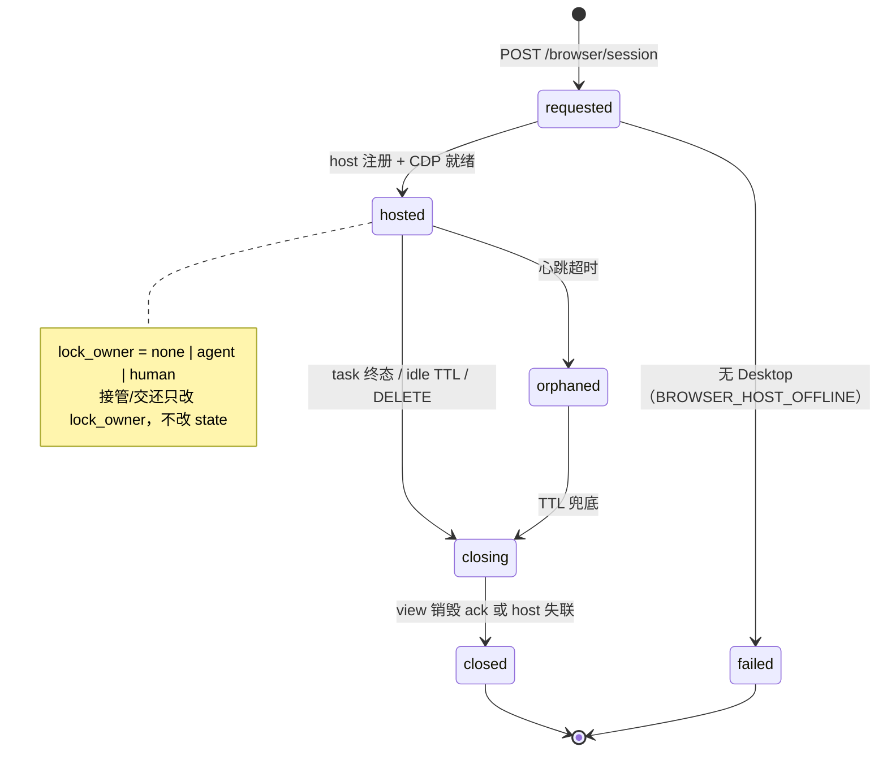

# QA 内置隔离浏览器 — 契约规范（SDD）

> 状态：**待评审**。本文是 ORIO-7 的实现契约，不是开发授权。
> 输入：`QA内置隔离浏览器-确认稿.md`（commit `602c7a315`，D1–D7）、R1 PoC（`ce5bf8024` / `571e638c8`）。
> 确认稿不在本分支上（规划分支 `agent/agent/orio-7` 承载），需要时用 `git show 602c7a315:"docs/v0.9.1/QA内置隔离浏览器-确认稿.md"` 阅读。
> 基线：`main`。本文只描述契约，不含实现代码；PoC 目录 `docs/v0.9.1/poc-r1-electron-host/` 是证据，不进正式包。

## 1. 结论与不变量

方案分层：**daemon 拥有 session、工具面、锁、TTL；Desktop 承载可见窗口；agent 只经 daemon 的 `multica-browser` MCP 工具面操作**。以下六条是不可协商的不变量，断言它们的测试与实现同等重要：

| # | 不变量 | 违反后果 |
|---|--------|---------|
| I1 | 永不开启进程级 `--remote-debugging-port` / `--inspect` | 本机任意进程可 attach 主渲染 target，用户 token 泄露 |
| I2 | 每个 task 一个非持久 partition；partition 名带 task id | 跨 task Cookie/localStorage 串用 |
| I3 | 同一 session 的 view 在显示/隐藏、接管/交还全程不重建 | 页面状态丢失，A3 失守 |
| I4 | QA view 固定 `backgroundThrottling: false` | 窗口隐藏后 rAF 归零，agent 等待条件与懒加载全部失效（PoC 对照组实测 0.0 次/秒） |
| I5 | 隐藏窗口的证据截图只走 `webContents.capturePage()` | `Page.captureScreenshot(fromSurface:true)` 永不返回（PoC 实测 >10s 超时） |
| I6 | 清理幂等，且两阶段（先关 view，后删目录） | 目录删除失败 → 残留；重复清理 → 报错或泄漏 |

## 2. 组件与所有权



> 📖 **图解说明**
>
> **本图表示**：session 的六个 state 与它们的进入路径。**接管不是 state**——它只改 `lock_owner`，一个 `hosted` session 在 agent 与人之间来回切换时不发生任何状态迁移，否则"交还"会变成一次非法转换。`requested` 只在"task 已申请、Desktop 还没挂上"的窗口期存在；`orphaned` 是 Desktop 失联但 view 可能还活着的不确定态。
>
> **关键点**：`closing` 是唯一会删除磁盘目录的状态，且只能从 `hosted` / `orphaned` 进入——`requested` 没有目录可删。`closed` 是唯一终态，重复 DELETE 落在 `closed` 上返回 200 而不是错误（I6）。
>
> **失败语义**：`failed` 只用于"从未成功托管"（例如 D3 的 Desktop 离线硬报错）；一旦 `hosted` 过，任何失败都走 `orphaned → closing`，不退回 `requested`。
>
> **锁与 state 正交**：`lock_owner=human` 时 `state` 仍是 `hosted`，心跳与 TTL 计时器照旧运行（D4 只暂停 idle TTL）。硬上限到期直接从 `hosted`（锁仍为 human）进 `closing`。

| 组件 | 位置（惯例参照） | 拥有 |
|------|-----------------|------|
| session registry | daemon 内存，类比 `server/internal/daemon/localenv/manager.go` | session 状态、task 绑定、锁 owner、TTL 计时 |
| host 通道 | daemon health mux（`health.go:449-470` 新增路由） | 宿主注册、心跳、两阶段清理 ack |
| `multica-browser` MCP | daemon 任务级 JSON-RPC server，类比 `plugin_hook_mcp.go` | 七类动作、锁强制、错误码 |
| QA 宿主窗口 | `apps/desktop/src/main/` 新增模块，类比 `index.ts` 的 `createIssueWindow` | view 创建/销毁、几何、`capturePage`、权限拦截 |
| 侧栏状态卡 | `packages/views/issues/components/` 新增组件 | 状态、URL、接管按钮、最近截图；**不含 view** |

数据库不变（确认稿 §3.5）。daemon 重启不恢复 session——registry 纯内存，重启即视为全部 `closed`。

## 3. Desktop ↔ daemon 契约

### 3.1 两条平面，两种凭据

| 平面 | 调用方 | 凭据 | 端点前缀 |
|------|--------|------|---------|
| task 平面 | task 内 CLI / daemon 工具面 | `MULTICA_TOKEN`（task token） | `/browser/...` |
| host 平面 | Desktop main | host secret | `/browser/host/...` |

**task 平面鉴权**直接复用现成机制：`registerActiveRepoCheckoutTask`（`health.go:135-153`）已在 `daemon.go:9212-9220` 按 provider 执行窗口注册/注销 task token，`activeRepoCheckoutTask(r)`（`health.go:179-196`）解析 `Authorization: Bearer`。browser session 复用同一张表，**不新增 token 体系**，也自动继承"任务结束即失效"的语义。

**host secret**：daemon 启动时生成 32 字节随机值（复用 `randomBrokerToken()` 形态，`remote_mcp_broker.go:185`），写入 `<profileDir>/browser-host.secret`，权限 `0600`（Windows 上以 ACL 限制当前用户）。Desktop 通过既有 profile 解析（`apps/desktop/src/main/daemon-profile.ts` 的 `profileDir`）读取，**不经过任何 HTTP 传输、不进日志、不进 prompt**。比对用常量时间比较。

**前置守卫按 body 形态分两组，不共用一个上限**：

| 组 | 端点 | Content-Type | 传输上限 | 长度要求 | 实现手法 |
|---|---|---|---|---|---|
| JSON 组 | 除 evidence 外的全部 | `application/json` | 64 KiB | 不限 | `ContentLength` 预检 + `MaxBytesReader` |
| 二进制组 | 仅 `POST /browser/host/evidence` | `image/png` | 6 MiB | **必须固定长度，禁止 chunked** | `ContentLength` 预检 + `MaxBytesReader` |

两组的公共前提都是 **`Origin` 头为空**，且都只接受 `POST`。这是 `environmentFocusHandler`（`environments.go:531-541`）已验证的形态：浏览器页面的 POST 必带 Origin，JSON body 需要 CORS 预检，而健康服务从不回 CORS 头。任何人复制这段守卫时不要为了"方便调试"删掉 Origin 检查。

**为什么 evidence 必须单独一组**：4 MiB 的 PNG 经 base64 编码约 5.3 MiB，套用 64 KiB 的 JSON 上限会被静默截断成一张坏图，且失败发生在解码之后（校验和先报错，看起来像传输问题）。二进制直传既避开 33% 膨胀，也让「多大算超限」只有一个数——不是「base64 后多大」。两组上限**不得互换**：把 JSON 组放宽到 6 MiB，等于给所有控制端点开了个大 body 的解析面；反过来把二进制组压到 64 KiB，则任何截图都进不来。

**超限必须是 `413`，不能退化成解析错误**。`LimitReader` 只把 body 截短到上限后返回 EOF，调用方看到的是「JSON 意外结束」——这与 §3.1.1 要求的 413 是两回事。两组都改用 `http.MaxBytesReader`（超限返回 `*http.MaxBytesError`），在读取处把该错误显式映射成 `413`；`ContentLength` 预检只是省掉一次无谓读取的快速路径，不是唯一防线。

### 3.1.1 evidence 端点的长度语义

长度要求与校验口径必须成对定义，否则「`Content-Length == bytes`」与「`MaxBytesReader` 兜 chunked」互相矛盾：

| 规则 | 内容 |
|---|---|
| 固定长度 | `r.ContentLength < 0`（chunked 或未声明）→ **`411 Length Required`**，不读 body |
| 传输上限 | `r.ContentLength > 6 MiB` → `413`，不读 body |
| 读取 | `MaxBytesReader` 仅作越界兜底：头声明 3 MiB 却发 8 MiB 时截断并报错，映射 `413` |
| 产物校验 | 读完后断言 **实际读取字节数 == query 的 `bytes`**，再算 `sha256`；任一不符 → `400`。请求头的 `Content-Length` 只用于上两行的传输判定，不参与产物校验 |

`411` 与 `413` 分开而不是合成 `400`：前者是客户端选错了传输方式（改成固定长度即可），后者是产物本身就超限（需要先让页面变小或调高上限，改传输方式没用）。

这套分法也是「长度可校验」与「越界有兜底」唯一不打架的组合：固定长度保证了产物校验有确定的字节数可比，`MaxBytesReader` 只在头撒谎时兜底，而 chunked 被 `411` 挡在读取之前。

### 3.2 端点表

| 方法 路径 | 凭据 | 语义 |
|---|---|---|
| `POST /browser/session` | task token | 幂等创建或取回本 task 的 session；无 host 时返回 `BROWSER_HOST_OFFLINE` |
| `GET /browser/session` | task token | 查询状态、锁、当前 URL 的 host+path（不含 query 值） |
| `DELETE /browser/session` | task token | 进入 `closing`；已 `closed` 返回 200 |
| `POST /browser/session/takeover` | **仅 host secret** | 锁置 `human`；只接受合法转换 |
| `POST /browser/session/release` | **仅 host secret** | 锁置 `agent` |
| `POST /browser/host/register` | host secret | Desktop 挂载 view，上报 `task_id`、`cdp_ready`、`window_id` |
| `POST /browser/host/heartbeat` | host secret | `{session_id, seq, view_alive}`；`seq` 严格递增，陈旧值丢弃 |
| `POST /browser/host/session/closed` | host secret | 两阶段清理的第二阶段 ack |
| `POST /browser/host/evidence` | host secret | 二进制组，**必须固定长度**（chunked → 411）：回传 `capturePage()` 的 PNG 字节 + URL 元数据（§3.1.1、§5） |

响应一律 `{"code": "...", "message": "...", "session": {...}}`；不使用裸文本 4xx（`environmentFocusHandler` 的 `{"reason","error"}` 形态已证明可让 Desktop 区分"daemon 太旧"与"业务失败"）。

**takeover / release 只认 host secret，不接受 task token**，这是锁能成立的前提：如果 agent 手里的 token 也能 release，它就能在人正操作时把自己的锁解掉，整个 D1 的强制力归零。agent 侧只能通过 `DELETE /browser/session` 主动放弃 session。

### 3.3 session 视图（对外稳定字段）

```json
{
  "session_id": "bs_<16 hex>",
  "task_id": "...", "issue_id": "...",
  "state": "requested|hosted|orphaned|closing|closed|failed",
  "lock_owner": "none|agent|human",
  "url": { "host": "127.0.0.1:3000", "path": "/dashboard" },
  "partition": "qa-task-<taskID>",
  "capability": "full|none",
  "started_at": "...", "idle_expires_at": "...", "hard_deadline": "...",
  "last_evidence": { "attachment_id": "...", "captured_at": "...", "viewport_only": true },
  "error": { "code": "...", "message": "..." }
}
```

**URL 只出 host+path**：query 里可能有一次性 token（确认稿 §3.7）。`last_evidence` 只给 attachment id，不给本地路径。

`capability=none` 表示该 task 的 provider 无法承载 HTTP MCP（见 §8 第 3 条）：侧栏入口必须置灰并给出原因，而不是显示一个点了没反应的按钮。

### 3.4 TTL（D4）

| 计时器 | 默认 | 行为 |
|--------|------|------|
| idle TTL | **15 min**（建议默认，待用户确认，见 §11 P1） | 无工具调用且无心跳活动时计时；人持锁期间**暂停** |
| 人接管硬上限 | 30 min | 从 `lock_owner` 变 `human` 起算，到期强制 `closing`，**不受 idle 暂停影响**（D4，已拍板） |
| Desktop 心跳超时 | 10 s（5 s 间隔，连续 2 次缺失） | `hosted` → `orphaned`（锁为 human 时同样适用），随后按 idle TTL 兜底清理 |

**idle TTL 的数值确认稿没有给，本文取 15 min 作为建议默认**（见 §11 P1）——需用户拍板或按 A4 的实际节奏调整。它只决定"agent 停了、人也不看"时多久回收，不影响任何验收项；判据来自对比：`localenv` 的 `DefaultTTL` 是 24 h（`server/internal/daemon/localenv/config.go:28`），那是给开发服务器用的，浏览器 session 借用同一量级会留下长时间可用的登录态页面，与"不残留"冲突。

三个计时器都在 daemon 单侧判定，Desktop 不参与裁决（确认稿 §3.1）。`localenv` 的 `Tick()`（`manager.go:359`）是现成的扫描循环范式，但**不要**复用它的磁盘 record 持久化——browser session 纯内存。

## 4. 视图生命周期与两阶段清理

### 4.1 创建

`POST /browser/session` → daemon 记 `requested` → 通知 host 平面（Desktop 前台在线时）→ Desktop main 建 `BaseWindow` + `WebContentsView`：

```
partition: `qa-task-${taskID}`      // 非持久，进程退出即无痕
sandbox: true, contextIsolation: true, nodeIntegration: false
backgroundThrottling: false          // I4，硬性
webSecurity: true                    // 决不复用主渲染的 webSecurity:false + plugins:true
— 无 preload —
```

主渲染的 `createRendererWebPreferences`（`renderer-web-preferences.ts`）明确带着 `webSecurity: false` 与 `plugins: true`，**QA view 必须另起一份偏好对象**，不得复用该函数。

窗口本体：`installWindowShortcutHandler`（`index.ts:397`）只装在主窗口与 issue 窗口上，**QA 窗口不装**——否则 Ctrl+R 被吞、Ctrl+1..9 被解释成切 tab、页面 Ctrl+W 会关掉 Multica 的 tab。同时必须为 QA view 单独设置：

- `setWindowOpenHandler` → `{ action: "deny" }`，`target=_blank` 改为同 view 内 `loadURL`（不是 `openExternalSafely`）
- `session.setPermissionRequestHandler` → 全部 deny
- `will-download` → `event.preventDefault()`（`index.ts:103-112` 已有同款守卫，但那是主 session 的保存对话框，QA partition 要独立一份，且策略是**拒绝**而非弹框）
- 导航白名单：仅 `http:` / `https:`

### 4.2 两阶段清理

```
closing
  ├─ ① Desktop main 销毁 WebContentsView
  │    （销毁前若 session 要求留证，先 capturePage 一次，见 §5）
  ├─ ② 收到 closed ack，或心跳超时
  └─ ③ 删 profile 目录 → closed
       删失败 → 进待清理队列，每 60 s 重试，3 次后记 WARN 并保留队列项
```

顺序不可交换：先删目录会与仍存活的 renderer 抢文件锁（Windows 上必失败）。`persist:` 前缀已经排除（确认稿 §7），目录通常只有零散缓存；删除**必须按本次 session 记录的绝对路径**执行，不做通配扫描。

Desktop 侧对称义务：检测到 daemon 失联（既有 `probeProfileHealth` 轮询即信号）后，销毁本机所有 QA view，避免"daemon 以为结束了，用户还开着一个能点但无响应的窗口"。

### 4.3 不重建的落点

view 只由 main 的 `Map<sessionId, { window, view }>` 持有。renderer **绝不**按 React 挂载周期创建/销毁 view——`tab-content.tsx` 一次只挂一个 tab，切 tab 会卸载整棵子树；若由组件驱动生命周期，切一次 tab 就重载一次 QA 页面（I3）。renderer 只发送"显示/隐藏/几何"三类指令。

### 4.4 renderer ↔ main 的 IPC 面

共 **7 个通道**，一个通道一个名字——`takeover` 与 `release` 是两个独立通道，不是同一个通道的两个分支（合并会让"谁解的锁"在日志里不可区分）。

| # | 通道 | 方向 | 载荷 | 前置校验 |
|---|---|---|---|---|
| 1 | `qa-browser:open` | invoke | `{ taskId, issueId }` | 发送方必须有 `BrowserWindow.fromWebContents`（同 `window:open-issue`，`index.ts:827-831`） |
| 2 | `qa-browser:session-state` | invoke | 无 | 同上 |
| 3 | `qa-browser:toggle` | send | `{ sessionId, visible }` | `sessionId` 必须在该窗口的已知集合内 |
| 4 | `qa-browser:bounds` | send | `{ sessionId, rect }`（CSS px，仅矩形） | 同上；main 侧再乘缩放并 clamp |
| 5 | `qa-browser:takeover` | invoke | `{ sessionId }` | 同上 |
| 6 | `qa-browser:release` | invoke | `{ sessionId }` | 同上 |
| 7 | `qa-browser:evidence` | invoke | `{ sessionId }` → 手动留证 | 同上 |

`toggle` / `bounds` 走 `send` 而非 `invoke`：它们按帧触发（发 `invoke` 会积压未等待的 Promise）。`sessionId` 一律由 main 侧白名单校验——renderer 传什么都不能指定任意 view，否则一个被注入的 renderer 就能控制别的 task 的浏览器。

侧栏状态卡自己不持有 view、也不缓存 session 内容；它只读 `qa-browser:session-state` 的返回值，用 TanStack Query 作 server 数据的缓存层（AGENTS.md 的状态规则）。

## 5. 证据回传（`capturePage`）

**唯一生产者是 Desktop main**。链路：

```
main: view.webContents.capturePage()  →  NativeImage → PNG buffer
  → POST /browser/host/evidence   （host 平面，host secret，二进制组）
     Content-Type: image/png
     查询参数：session_id, bytes, sha256            （进 URL，是元数据）
     自定义头：X-QA-URL-Host, X-QA-URL-Path         （URL 拆开，header 不支持非 ASCII）
     body：PNG 原始字节（不做 base64）
  → daemon: 要求固定长度（缺 Content-Length → 411）→ 比 bytes 与 sha256
            （实际读取字节数，非请求头）→ 都对才落 attachment
            → redact.Text() 处理 URL（server/pkg/redact/redact.go:176）
  → 走既有 attachment 通道挂到 issue 评论
```

**console 文本不走这个端点**。daemon 本身拥有 `multica-browser` 工具面，`browser_console` 的返回已经在它手里，并且已经在工具边界过了 `redact.Text`；再让 host 回传一份等于是同一条数据两个来源，会不一致。同理，URL 的 `host+path` 由 host 上报是因为只有它读得到地址栏，console 不是。

**图片走 body，元数据走 header/query，不塞进 JSON**：这是上一版把 4 MiB 图 base64 进 JSON 又被 64 KiB 上限截断的根因。长度语义见 §3.1.1——本端点**不接受 chunked**，`Content-Length` 缺失即 `411`，因此传输长度与实际字节数始终有数可比。

URL 不能整条进 header：`X-QA-URL-Path` 只承载 path 部分（可能含百分号编码），host+port 单独放 `X-QA-URL-Host`。若 path 含非 ASCII，Client 侧用 `encodeURI` 后的形式，daemon 在用之前只做长度与字符白名单校验、不做反解——它只用于展示，不参与任何路由判断。

规则：

| 项 | 约束 |
|---|---|
| 触发点 | session 开始、关键状态变化、最终或失败，三类（A4） |
| 尺寸 | 默认仅视口，`capturePage()` 不带矩形；不拼整页 |
| 产物上限 | 单张 PNG ≤ 4 MiB，**只由 Desktop main 判定**（拿到 buffer 就测长度）：超限**不上传**，直接 `BROWSER_EVIDENCE_FAILED`。不做格式降级——见下方说明 |
| 时序 | **必须在 view 销毁前**完成；与 §4.2 ① 绑定 |
| 失败 | 重试 1 次 → `BROWSER_EVIDENCE_FAILED` 结构化错误，**不阻塞** task 终态 |
| 校验 | daemon 校验 **实际读取字节数 == query `bytes`** 与 `sha256`；任一不符 `400`，不落 attachment。（不比较请求头 `Content-Length`：它在传输层已由 §3.1.1 的固定长度规则保证，重复比较会与 chunked 兜底逻辑打架） |
| 含登录态 | D5：默认只截视口；上传含登录态画面需显式确认，未确认则只留本地不挂 issue |

不得使用 `Page.captureScreenshot` 作为主路径：PoC 在隐藏窗口上测得 10 s 超时且永不返回；`fromSurface:false` 虽返回但只有 2 种颜色，不可复核。

**为什么不做 JPEG 降级**：二进制组只接受 `image/png`（§3.1），§7 规定 `Content-Type` 不符即 `415`。降级重发等于让客户端自己触发 415，要么再加一个已接受的 MIME、第二个解码器和第二条测试口径。而 4 MiB 对一张 1000×720 的视口 PNG 是充裕的（PoC 实测 15.8 KB），触发降级的场景本身说明页面里有异常大的位图——那更该失败并让人看见，而不是悄悄换格式继续。若将来确实需要，再单独放宽 `415` 规则与本条，二者必须同改。

**图片本身无法脱敏**——`redact` 只处理文本。所以传入的 PNG 字节不做内容过滤，控制的落点是"截不截"（D5 的显式确认）而不是"截了再洗"。这条要写进使用说明，不能让用户以为系统会打码。

## 6. 几何与缩放

- `view.setBounds()` 的单位是 **DIP**，renderer 的 `getBoundingClientRect()` 是 **CSS px**。
- 换算：`dip = cssPx * webContents.getZoomFactor()`。PoC 实测 1000 DIP 在 1.5 倍缩放下 `innerWidth` 为 667。
- 几何同步：`ResizeObserver` + `requestAnimationFrame` 节流 + 命令式 `setBounds`，**不进 React state**（否则每次 resize 触发一次渲染）。
- 边界：`setBounds` 结果必须 clamp 到窗口 content 区域；窗口最小化时跳过更新，恢复时全量重算一次。
- 禁止从右/下边计算 `x2/y2` 再相减：DIP 是整数像素取整，累加误差会让 view 与容器错位 1px 并逐帧抖动。

这些规则要落成 `apps/desktop/src/main/` 下的**纯函数**（`computeViewBounds(rect, zoom, contentBounds)`），单测覆盖四档缩放（0.5 / 1 / 1.5 / 2）+ clamp + 最小化跳过。现有 vitest 已把 `electron` 别名到 `test/electron-guard.ts`，纯函数测试不需要 mock Electron。

## 7. 接管锁与错误码

锁在 daemon registry，**唯一裁决点**。所有 agent 动作经 `multica-browser` MCP 进入，因此锁在这里有强制力（这是 D1 换掉第三方 Playwright MCP 的唯一理由）。

| 工具调用时机 | 行为 |
|---|---|
| `lock_owner=agent` | 正常执行 |
| `lock_owner=human` | **阻塞等待**，最长 30 s；期间交还则继续执行，超时返回 `BROWSER_TAKEN_OVER`（D2）。阻塞期间 `state` 一直是 `hosted`，`GET /browser/session` 可随时读到 `lock_owner=human` |
| `state=orphaned` | 立即 `BROWSER_SESSION_UNAVAILABLE` |
| `state=closed` | 立即 `BROWSER_SESSION_CLOSED` |

读类动作（`snapshot`、`get_url`、`console`）在 `human` 锁下**不阻塞**：daemon 回收 session 与生成状态仍需要它们。写类动作（click/fill/wheel/key/screenshot）一律受锁约束——PoC 已验证宿主侧同一闸门可同时拒绝 `Input.*` 与截图。

| 错误码 | HTTP | 触发 |
|---|---|---|
| `BROWSER_HOST_OFFLINE` | 503 | 无 Desktop 宿主（D3 硬报错，不排队） |
| `BROWSER_SESSION_UNAVAILABLE` | 409 | session `requested`/`orphaned` |
| `BROWSER_TAKEN_OVER` | 409 | 人持锁超时 |
| `BROWSER_SESSION_CLOSED` | 410 | session 已 `closed` |
| `BROWSER_CAPABILITY_UNSUPPORTED` | 501 | view 已销毁但仍尝试动作 |
| `BROWSER_EVIDENCE_FAILED` | 200 + `isError` | 截图连续失败（工具错误，非协议错误） |
| `BROWSER_STALE_REF` | 200 + `isError` | `ref` 来自已导航前的 snapshot，需重新 snapshot |

上表是 **MCP 工具面**的错误码（agent 看到的东西）。HTTP 平面另有五个传输层状态，它们不映射成工具错误码，因为 agent 无从修正：

| 状态 | 触发 | 响应体 |
|---|---|---|
| `400` | 证据校验失败（实际字节数或 `sha256` 与 query 不符）、JSON 解析失败 | `{"code":"BAD_REQUEST","message":"..."}` |
| `403` | 凭据有效但 `session.TaskID != token 的 task_id`（跨 task），或 `Origin` 非空 | 同上 |
| `411` | evidence 端点缺 `Content-Length`（chunked 或未声明，见 §3.1.1） | 同上 |
| `413` | body 超所在组上限（JSON 组 64 KiB / 二进制组 6 MiB），**在读 body 前由 `ContentLength` 判定**；`MaxBytesReader` 越界同样映射为此码 | 同上 |
| `415` | `Content-Type` 与端点组不符（如给 evidence 发 `application/json`，或给 JSON 组发 `image/png`） | 同上 |

MCP 层的工具错误沿用 `plugin_hook_mcp.go:219-227` 的语义：`isError: true` + 文本内容，agent 读得到并自行决定继续或结束——不要升级成 JSON-RPC 协议错误（那会让 CLI 直接崩溃重试）。

**task 绑定校验**是跨 task 越权的唯一拦截点：每个端点先解析 token → 得到 `task_id`，再断言 `session.TaskID == token 绑定的 task_id`，不等即 403。不要相信请求体里的 `task_id`（`repoCheckoutHandler` 的 `health.go:506-509` 是现成范式）。

## 8. MCP 注入

`multica-browser` 必须**在 CLI 子进程启动前**写入，对启用该功能的 task **无条件预注入**（确认稿 §3.2），端点惰性——没有 session 时工具调用返回 `BROWSER_SESSION_UNAVAILABLE`，而不是让 agent 找不到工具。

实现位置：`daemon.go:8299-8319` 的 MCP 组装段（`if task.Agent != nil` 起，到 `mergeTaskRemoteMCPConfig` 结束）。三条硬约束：

1. **不得走 `mergeRuntimeAndAgentMcpConfig` 的 nil 早退**（`runtime_mcp.go:36-40`）。该函数对 `nil`/`null` agent config 直接返回原值，预注入会静默丢失。
2. **必须先折叠再追加**：用 `mergeTaskRemoteMCPConfig`（`remote_mcp_broker.go:449-475`）的形态——把 runtime servers 作文档基座，再把 `multica-browser` 作为 overlay 写进 `mcpServers`，不能挤掉用户既有 MCP。
3. **provider 覆盖**：能承载 HTTP MCP 的 provider 见 `providerSupportsRemoteMCPBroker`（`remote_mcp_broker.go:159-166`）。不在集合内的 task 不注入，并在 session 视图上标 `capability: none`，Desktop 侧栏入口置灰并说明原因——不要让它变成"agent 找不到工具"的无声失败。

`@playwright/mcp` 与 `npx -y` 注入形态随 D1 作废（确认稿 §7），`browser_mcp_config.go` 的 Windows 加固保留给用户自配的 MCP，**不要**把它接到本功能上：它的 `--cdp-endpoint` 早退分支（`browser_mcp_config.go:80-82`）在这里永远不会命中。

### 8.1 工具集（七类动作，不追求 Playwright 全集）

| 工具 | 参数 | 对应 PoC 验证 | 受锁约束 |
|---|---|---|---|
| `browser_goto` | `url`（仅 http/https） | `Page.navigate` + `did-fail-load` 捕获 | 是 |
| `browser_snapshot` | 无 | `Accessibility.getFullAXTree`（PoC：17 节点，含 textbox/button） | 否（读） |
| `browser_click` | `ref` 或 `text` | `Input.dispatchMouseEvent` 三段式 | 是 |
| `browser_fill` | `ref`, `value` | `focus` + `Input.insertText` | 是 |
| `browser_wheel` | `deltaY`, 可选 `x/y` | `Input.dispatchMouseEvent(mouseWheel)` | 是 |
| `browser_wait` | `condition`（超时上限 30 s，与锁等待共用一个预算） | 轮询谓词 | 是 |
| `browser_screenshot` | 无 | 由 daemon 转 host 平面调 `capturePage()`（**不是** CDP，见 §5） | 是 |

补充工具（只读，不进七类）：`browser_console`（返回最近 N 条 console 文本，已过 `redact.Text`）、`browser_url`（host+path）。

**`browser_wait` 与锁共用 30 s 预算**是刻意的：否则"人接管 + agent 在 wait 里挂 30 s + 再等锁 30 s"会让一次工具调用最长 60 s，超过多数 CLI 的单次调用超时，表现为 agent 无解释地中断。实现时用一个 `context.WithTimeout` 覆盖整个调用。

**`ref` 的来源**：`browser_snapshot` 返回带 `ref` 的扁平节点列表（不返回原始 a11y 树——Electron target 的树里含大量 `none`/`InlineTextBox` 噪声，PoC 的 17 节点里只有 14 个带名字）。`ref` 在一次 snapshot 内有效，页面导航后失效并返回 `BROWSER_STALE_REF`，让 agent 重新 snapshot 而不是静默点错元素。

**`browser_screenshot` 与 `browser_goto` 的顺序耦合**：截图走 host 平面时，daemon 需要先确认 host 还活着；host 失联时立刻 `BROWSER_SESSION_UNAVAILABLE`，不要等到 HTTP 超时（Desktop 崩溃场景下这是 A5 要求的"固定超时内返回"）。

## 9. 测试

按仓库分层，不新造一层：

| 层 | 覆盖 | 位置 |
|---|---|---|
| Go 单测 | registry 状态机（§2 全转换）、TTL 三计时器、锁阻塞与解阻塞、鉴权矩阵（无凭据 / 错 token / 跨 task / 错 secret）、幂等 DELETE、清理重试、URL 脱敏、MCP 折叠不丢用户 server | `server/internal/daemon/*_test.go`，用 `testutil` 与现有 `d.registerActiveRepoCheckoutTask` 测试范式 |
| Desktop 单测 | `computeViewBounds` 四档缩放 + clamp + 最小化、session→view 映射不重建、两阶段清理顺序、host 心跳失联、权限/下载/`window.open` 拦截表 | `apps/desktop/src/main/*.test.ts`（vitest，electron 已被别名到 guard） |
| 组件测试 | 侧栏状态卡（`hosted`/`orphaned`/`closing`/`closed`/`failed` + `capability=none`）、接管/交还按钮禁用态、Desktop 离线提示、中英 locale 同步 | `packages/views/issues/components/*.test.tsx` |
| IPC 契约 | **7 个** `qa-browser:*` 通道（§4.4 逐个列举）的发送方校验、`sessionId` 白名单、未知 session 的拒绝；测试用一张与被测清单同源的常量表驱动，避免新增通道漏测 | `apps/desktop/src/main/*.test.ts` |
| 集成（本机） | daemon + Electron 宿主起停一轮、隐藏态截图非空、清理后目录消失 | 扩展现有 PoC 脚本为 `scripts/` 下的 harness，Windows 真机跑，CI 不强制（需 GUI） |
| 人工 | A1 前后台快照、A3 画面连续性、A4 内容充分性、A7 截图 PII 抽查 | issue 内清单 |

必须有的失败/恢复用例（每条都要有测试，不能只写在文档里）：

1. Desktop 未启动 → `BROWSER_HOST_OFFLINE`，**不排队**、不重试。
2. 心跳 10 s 缺失 → `orphaned`；恢复心跳**不复活**，只能新建 session。
3. 人接管后忘记交还 → 30 min 硬上限清理，锁不阻塞回收。
4. task 终态时用户仍在看 → view 先关闭，用户看到明确"会话已结束"，不静默消失。
5. 重复创建 / 重复 DELETE → 幂等，返回同一 session / 200。
6. view 被强杀（`render-process-gone`）→ 下一次工具调用 `BROWSER_CAPABILITY_UNSUPPORTED`，已采集证据仍在。
7. 截图失败两次 → `BROWSER_EVIDENCE_FAILED`，task 仍能终态。
8. 导航后使用旧 `ref` → `BROWSER_STALE_REF`，不误点。
9. 人接管 + `browser_wait` 同时在飞 → 单次调用总耗时不超过 30 s 预算，不出现 60 s 静默。
10. **4 MiB 边界截图完整入 attachment**：构造一张 PNG 恰好 ≤ 4 MiB（同时断言其 base64 后 > 5 MiB，用来钉住"不能走 JSON 组"这个结论），走完整 `capturePage → /browser/host/evidence → attachment` 链路，断言落库字节数与 `sha256` 与源一致、图片可解码且尺寸正确。
11. **超过 4 MiB 在 Desktop main 侧就被拦下**：构造 4 MiB + 1 KiB 的 PNG，断言 main **不发请求**、直接返回 `BROWSER_EVIDENCE_FAILED`，daemon 侧无任何 evidence 请求记录。注意：daemon 的传输上限是 6 MiB，4 MiB + 1 KiB 到了 daemon 会被放行——所以这条必须落在 main 侧断言，不能在 daemon 侧测。
12. **两组上限不得互换**：向 JSON 组端点发 6 MiB body 必须 `413`（不是 JSON 解析错误）；向 evidence 发 `Content-Type: application/json` 必须 `415`；向 JSON 组发 `image/png` 同样 `415`。把"两组分开"变成可执行约束。
13. **evidence 不接受 chunked**：用 `Transfer-Encoding: chunked` 发同一份 PNG 必须 `411`，且不读 body、不落 attachment。
14. **传输上限与产物上限互不冒充**：向 daemon 发 6 MiB + 1 KiB 的 evidence 必须 `413`（传输层）；发 5 MiB 的必须成功落库（在传输层之内，产物上限不归 daemon 管）。
15. 证据校验失败：实际读取字节数与 query `bytes` 不符、或 `sha256` 不符 → `400`，且**不落 attachment**（防止半张图进 issue）。

## 10. 回滚

功能默认关闭（feature flag，服务端 `packages/core/api/schemas.ts` 的 `feature_flags` 与 `server/pkg/featureflag` 已有机制）。关闭后：

- 不注入 `multica-browser` MCP → agent 侧无工具，不产生任何 session；
- 侧栏入口不渲染 → renderer 不发任何 host 指令；
- 现存 session 按正常 `closing` 流程回收，**不重建、不迁移**；
- 不改数据库、不动既有 issue 流程、不需要回滚脚本。

回滚判据：任一不变量（§1 I1–I6）在真实环境被违反，且无法在两小时内修正 → 关 flag，按 Plan B 评估。

## 11. 待决风险与验证矩阵

| # | 风险 | 现状 | 验证方式 | 阻塞？ |
|---|---|---|---|---|
| V1 | Electron 44.9.x 与 PoC 用的 44.7.0 行为差异 | 未验证；仓库声明 `^44.9.3` | 实现首个 PR 后在仓库实际版本上重跑 harness | 否 |
| V2 | host secret 正式链路（当前 PoC 在 main 内直接表达锁） | 契约已定，未实现 | 集成测试：错 secret、跨 session、重放陈旧 `seq` | 否 |
| V3 | 窗口**最小化**（非 hide）时 view 与截图行为 | 未验证 | harness 补一个最小化分支 | 否 |
| V4 | 真实业务页面的 a11y 树规模与 ref 解析开销 | 只在 17 节点合成页验证 | 用真实验收环境测一次，记录节点数与耗时 | 否 |
| V5 | `render-process-gone` 后的 view 重建与 session 语义 | 未验证 | 集成测试覆盖崩溃恢复（§9 第 6 条） | 否 |
| V6 | Windows 文件锁导致目录删除失败 | 概率未知 | 保留待清理队列 + 重试；监控 WARN 频率 | 否 |
| V7 | 320px 侧栏放不下任何可用浏览器画面 | 已定论：不内嵌，独立窗口 | 无需再验 | — |
| V8 | **idle TTL 数值（15 min）未经用户确认** | 确认稿给了"暂停 + 30 min 硬上限"，没给空闲值；本文按建议默认 15 min 先行 | 见 §3.4 与 P1；改值只动一个常量 | 否 |
| V9 | 侧栏状态卡的最近截图是否直连 attachment URL | 未定；涉及能力签名过期 | 实现时按既有 `useDownloadAttachment` 取值 | 否 |

**待用户拍板的三项**（下表是本文已采用的建议默认，用户回"按建议确认"即生效；实现按该默认先行，改值只影响常量与一处交互，不改契约结构）：

| # | 项 | 本文采用值 | 理由与改动成本 |
|---|---|---|---|
| P1 | idle TTL | **15 min** | 只影响"agent 停了且人也不看"的回收；开发服务器的 24 h（`localenv/config.go:28`）会留下长时间可用的登录态页面。改值 = 一个常量 |
| P2 | `capability=none` 的侧栏入口 | **显示但置灰并说明原因** | 完全隐藏会让用户不知道为什么没有入口；置灰只需一份文案 |
| P3 | 人接管时的窗口前置 | **仅在用户显式点击"接管"时置前**；agent 启动、心跳、后台执行都不置前 | 用户主动操作有明确预期，agent 自动运行不打断用户——这条同时是 A1「不打扰」判据的一部分 |

P3 越界的具体表现要一并写进 A1：若 agent 启动或后台恢复时把窗口提到前台，视为 A1 不通过。

## 12. 分阶段实现顺序

1. daemon registry + task 平面鉴权 + 幂等 CRUD（无 Desktop 依赖，可全单测）。
2. Desktop host 模块：view 创建/销毁、偏好、权限拦截、`computeViewBounds`。
3. host 平面：注册、心跳、两阶段清理。
4. `multica-browser` MCP + 锁 + 错误码 + MCP 注入折叠。
5. `capturePage` 证据链路 + attachment 回流 + 脱敏。
6. 侧栏状态卡与接管按钮 + locale。
7. 本机 harness 与人工验收清单。

前四步完成前不合并任何 UI 代码——否则会出现"按钮先上线、后端返回 501"的返工。

## 13. 实现记录（阶段 1–6 落地时对契约的两处补充）

本节记录实现时对 §3.2 端点表的**两处新增**，以及一处 §12 未列出的必要改动。三项都是"不加就做不出来"，不是范围扩张；已同步给评审。

### 13.1 host 平面新增 `POST /browser/host/session`

§3.2 只有 task 平面能创建 session（`POST /browser/session`，凭 task token）。但侧栏状态卡由人点击"打开"，Desktop main 手里**没有 task token**——它只有 host secret。

- 凭据：host secret
- body：`task_id`（必填）、`issue_id`、`workspace_id`、`agent_id`
- `task_id` 必须匹配 `^[A-Za-z0-9_-]{1,128}$`，否则 **400**，不进 registry
- task 必须**是本 daemon 正在运行的**（claim 期已记录 capability），否则 **404**。host 平面只能确认 task，不能凭空声明一个
- 语义：幂等创建或取回该 task 的 session，与 task 平面的创建共用同一个 registry 条目
- 响应：`{"code":"OK","session":{...}}`

> 安全复核 P0-1/P1-3 后收紧：原实现接受任意 `task_id` 并默认给 `capability=full`，使 session 的 `TaskID` 变成"调用方声明值"。

### 13.2 host 平面新增 `GET /browser/host/sessions`

Desktop 启动或恢复后需要知道"这台机器上还有哪些 session 没挂 view"。没有发现端点时，它只能等心跳超时后由 daemon 判 `orphaned`，而 §9 第 2 条明确禁止复活。

- 凭据：host secret
- 语义：返回本 daemon 全部非 `closed` session 的 §3.3 视图
- 副作用：无（只读），同时刷新 host 在线时间

### 13.3 `capability` 由 daemon 派生，不接受请求体

`POST /browser/session` 的 body 被接受但**忽略**：`capability` 只来自 daemon 记录的 provider 判定（`providerSupportsRemoteMCPBroker`）。若允许调用方声明 `full`，一个无法承载 HTTP MCP 的 provider 就会拿到一个"入口可点、工具不存在"的 session——正是 §8 第 3 条要消除的静默失败。

### 13.4 清理不删目录（P1-4 拍板的最小方案）

QA view 的 partition 是**非持久**的（`qa-task-<hash>`，无 `persist:` 前缀），Chromium 把 Cookie/localStorage 留在进程内，**不会写 profile 目录**。所以 daemon 侧原本的 `os.RemoveAll(HostProfileDir)` 删的是一个从不存在的目录：它不带来隔离（A2 由 partition 名保证），只带来 P0-1 那条任意路径删除。

据此**删掉整条目录清理路径**：

- `register` 不再接受 `profile_dir`（该字段唯一的用途就是给删除提供输入）；
- registry 不再持有目录，`cleanupLocked` 只做终结；
- 重试队列与 `RemoveAll` 一并移除；
- A6 的口径改为「view 已销毁 + registry 已清空 + 无残留进程」，不再是「目录消失」。

将来若要支持持久化 partition，必须重新引入目录所有权，并同时落地标识符校验、哈希化命名与受管根前缀校验。

### 13.5 `capability` 的默认值

未被 claim 记录 decision 的 task 一律 `capability=none`（原为 `full`）。理由是 task 平面越权拦截断言的是 `session.TaskID == token 的 task_id`，若 host 平面能手造任意 task 的 session，"声明值"就会顶替"确认值"。本轮不引入 `observe` 语义；将来要支持已结束运行的只读观察，须单独立项。

### 13.6 `browser_screenshot` 是真实动作

`browser_screenshot` 在 Desktop `execute()` 里有独立分支：`capturePage()` → 4 MiB 产物上限（main 侧判定，超限不发请求）→ `POST /browser/host/evidence` → 返回 attachment id。它是 A4 唯一的自动化证据来源，不是侧栏按钮的别名。

### 13.7 侧栏入口的渲染条件

`qa_browser` 是前端公开 flag（`server/internal/featureflags` 的 `frontendPublicFlags` + `packages/core/feature-flags` 的 `QA_BROWSER_FLAG`）。关闭时侧栏整段不渲染；`capability=none` 时按 P2 渲染**置灰并说明原因**的入口。两者不同：前者是发布开关，后者是单次运行的固有限制。

Desktop main **不读这个 flag**：它没有 server session，拿不到决定。因此 main 侧始终安装 IPC 与宿主；无 session 时不建 view、不轮询、无命令，空闲成本是一个已注册的 IPC 面。这一点已写进 `qa-browser-setup.ts` 的注释，取代此前"main 也被 flag 门控"的错误说法。

### 13.8 导航与 task 终态（P2-6/P2-7）

- QA view 除 `setWindowOpenHandler` 外，还装 `will-navigate` 与 `will-redirect`：非 `http`/`https` 一律 `preventDefault()`。缺这两个钩子时，页面自己跳到 `file://` 会渲染本机文件，再被证据截图传进 issue。
- task 调用 `runTask` 的 defer 关闭本 task 的 session：task 终态时 agent 进程已退出、token 已回收，没人能再发 `DELETE`，只靠 idle TTL 会让窗口多活最多 15 分钟。

### 13.9 残余风险（返修后）

| # | 风险 | owner | 状态 |
|---|---|---|---|
| V1 | 仓库实际 Electron 44.9.x 上的行为未验证 | 研发 | 阶段 7 harness 已在真实 Electron 上跑通一次（见 issue 证据），但未覆盖多窗口与长时间运行 |
| V3 | 窗口**最小化**（非 hide）时 view 与截图行为 | 研发 | 未验证 |
| V4 | 真实业务页面的 a11y 树规模与 ref 解析开销 | QA | 未验证，需真实验收环境 |
| V5 | `render-process-gone` 后的 view 重建语义 | 研发 | 单测覆盖"view_alive=false → orphaned"，真实崩溃未验证 |
| V6 | 持久化 partition 的目录所有权 | 研发 | 本轮明确不做；若将来做，见 §13.4 末段 |
| V9 | 侧栏最近截图是否直连 attachment URL | 前端 | 未定，按既有 `useDownloadAttachment` 取值 |
| V10 | `browser_wait` 的 condition 在被测页面内求值 | 安全 | 已评估：agent 自己给的表达式，运行于被测页面上下文，不触及本机权限 |
